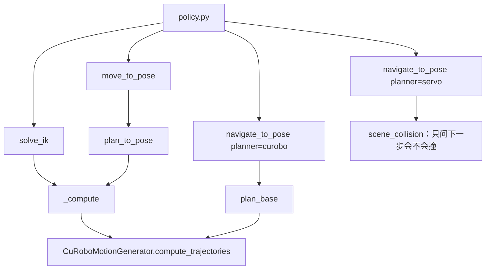
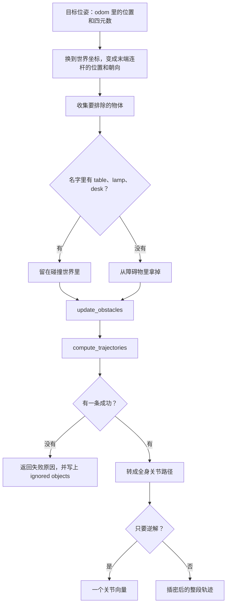
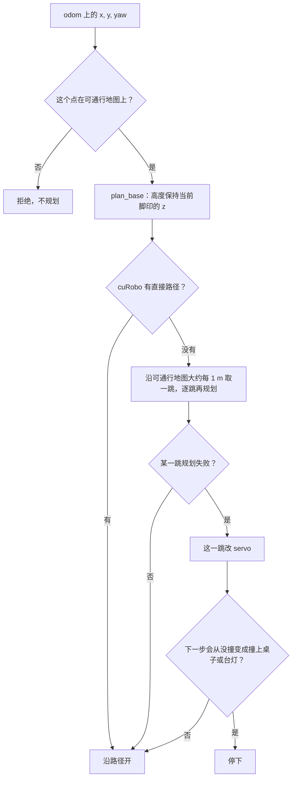

# `planning.py`：cuRobo 规划的流程

本文说明 `src/cap_harness/behavior/planning.py`。R1 Pro 和 Gento Skye 走的是同一份代码。它不迈仿真步，只回答「从现在的关节出发，有没有一条不撞的关节路径」。真正执行的是 `adapter.py`：`move_to_pose` 和 `navigate_to_pose` 拿到路径后再走。

碰撞球怎么摆、为什么 Gento 会servo 进桌子，见 [gento-skye-collision-spheres.md](gento-skye-collision-spheres.md)。策略怎么调用这些接口，见 [gento-skye-policy.md](gento-skye-policy.md)。

## 1. 文件里有什么

文件里只有一个类，`OmniGibsonCuroboPlanner`。它包着 OmniGibson 的 `CuRoboMotionGenerator`。策略碰得到的入口有四条，手臂的两条在内部汇合。

| 策略调用 | 本文件的函数 | 要的结果 |
| --- | --- | --- |
| `solve_ik` | `solve_ik` → `_compute(ik_only=True)` | 一个不撞的关节解，不要轨迹 |
| `move_to_pose` / `plan_motion` | `plan_to_pose` → `_compute(ik_only=False)` | 整段关节轨迹 |
| `navigate_to_pose(..., planner="curobo")` | `plan_base` | 底盘路径，不经过 `_compute` |
| `navigate_to_pose(..., planner="servo")` | `scene_collision` | 不规划。只判断下一步底盘会不会新撞上场景 |

`plan_to_pose` 成功后，只把这只手臂的关节裁出来交给控制器。全身关节另外存着。执行时腰如果在规划里动过，靠 `full_path_for` 一起放出来。相邻路点超过 `WAYPOINT_INTERPOLATION_RAD = 0.01` rad 时会先插密。

两只手同时规划走 `plan_synchronized_motion`，仍然进 `_compute`，只是目标位姿有两个。

## 2. 第一次调用时才建模型

`_generator_for` 在第一次规划时创建 `CuRoboMotionGenerator`，之后一直复用。它读的是机器人 yaml 里的球和关节，不是仿真网格。

默认的手臂 embodiment 里，腰是自由的，底盘和手指锁住。一次手臂规划因此可以连腰一起动。环境变量 `CAP_HARNESS_BEHAVIOR_LOCK_TORSO=1` 时，复制一份 yaml，把腰写进 `lock_joints`，这次规划就只动手臂。Gento 的策略通常先用 `move_torso` 把升降放到 0.25 m，再来规划；默认并没有把腰锁住。

cuRobo 有多套 embodiment。这份文件常用 ARM（手臂）和底盘那套。诊断才会拿 DEFAULT 做对比。

其他默认值：

| 常量 | 值 | 作用 |
| --- | --- | --- |
| `DEFAULT_BATCH_SIZE` | 1 | 一次并行几条种子。24 GB 显卡上和 Isaac 挤在一起，不再加大 |
| `PLAN_TIMEOUT_S` | 60 s | 一次 `compute_trajectories` 的上限 |
| `MAX_PLANNING_ATTEMPTS` | 100 | 逆解尝试次数上限 |
| `COLLISION_ACTIVATION_DISTANCE_M` | 0.02 m | 离障碍物 2 cm 以内算碰撞 |
| `GOAL_CONTAINMENT_MARGIN_M` | 0.02 m | 判断「点在不在物体盒子里」时，包围盒各向放宽 2 cm |
| `FINGER_XY_MARGIN_M` | 0.05 m | 只加在指心点上，水平再放宽 5 cm |

`collision_sphere_buffer: 0.002` 写在机器人 yaml 里，不在这个文件。所有球和场景比较时再加大 2 mm。

## 3. 手臂规划：`_compute`

`solve_ik` 和 `plan_to_pose` 只是在它前后加包装。主干每次都一样。

### 3.1 哪些物体不挡路

排除由三个点决定：

- 目标位姿的末端原点。
- 沿末端 +Z、距离 `0.85 × 平均指长` 的点，大约在指心。Gento 的末端原点在指心后方约 12 cm，只测原点时，收音机永远进不了包围盒，下探会报 `IK Fail; ignored objects: none`。
- 当前手指已经伸进去的点，以及辅助抓取已经抓住的物体。抬起时手里的东西要跟着走，不能再当障碍。

指心这一点的测试，包围盒在 x、y 上用 `FINGER_XY_MARGIN_M = 0.05`，z 上仍是 2 cm。铁丝提手伸出收音机根连杆的盒子时，5 cm 能把它算进去；竖直放宽太多会把手指下面的桌子也排除掉。

桌子、台灯、书桌（名字或类别里有 `table`、`lamp`、`desk`）即使点落在盒子里也不排除。下探可以进入收音机，不能穿过桌面。

### 3.2 cuRobo 里面的两步

`compute_trajectories` 先求一个不撞的逆解。`ik_only=True` 时到这里就返回。否则再从当前关节优化出一条轨迹。

失败信息里：

| 状态 | 含义 |
| --- | --- |
| `IK Fail` | 这个位姿没有不撞的关节解 |
| `TrajOpt Fail` | 有解，但从当前关节走过去的路径被挡住 |
| 含 `Start State` | 当前姿态自己已经在碰撞里。从这里规划不了，包括直线后退。调用方要先 servo 或 `move_to_joints` 退出来 |

初始关节只传一维向量 `_tensor(seed)`。`compute_trajectories` 自己会再 batch 一次。外面先 batch 成 `(B, D)`，里面再堆一层就变成 `(B, B, D)`，cuRobo 抛 `expand(... size=[])`，策略只能看到 `ik=False`。目标位姿仍然用 `_batched`，那一层是 cuRobo 要的。

逆解的关节如果已经带了被锁住的腰，`path_to_joint_trajectory(get_full_js=True)` 会因为重复追加 `lock_joints` 抛 `ValueError`。这时改用 `get_full_js=False`，解本身已经是完整的。

## 4. 底盘规划

`plan_base` 不改高度。平面底盘的目标 z 保持当前脚印的世界高度，否则逆解失败，整条路径都不会有。

`planner="servo"` 不进 `plan_base`。它把底盘目标每次挪一小步，只在已经有碰撞世界时问 `scene_collision`。已经贴着家具时允许往后退，所以能从桌子里撤出来。还没做过任何规划、碰撞世界不存在时，这一步不检查。

Gento 的策略在 cuRobo 拒绝桌边目标之后，会改用 servo 再朝收音机蠕行。撞到桌子的是这一段，不是 cuRobo 规划出一条穿桌的轨迹。

## 5. 诊断

默认全关，打开会拖慢运行。正式跑不要留着。

| 环境变量 | 打印前缀 | 做什么 |
| --- | --- | --- |
| `GENTO_EXCL_DIAG=1` | `GENTO_EXCL` | 目标点、指心点，以及最近 3 个物体的包围盒 |
| `GENTO_IK_FK_DIAG=1` | `GENTO_IKFK` | 这条逆解在 ARM、DEFAULT 两套模型下的正运动学，对照仿真里的末端 |
| `GENTO_IK_FAIL_DIAG=1` | `GENTO_IKFAIL` | 逆解失败后，先关掉场景碰撞重解，再关掉自碰撞重解，并列出重叠的连杆对 |
| `GENTO_PLAN_DIAG=1` | `GENTO_PLAN` | 复位后打印场景碰撞、自碰撞、限位、正运动学，以及原地和上抬 5 cm 的逆解自检 |

`diagnose_current_configuration` 可以传入 `q_override` 检查某一个关节向量，而不是当前仿真姿态。`_compute` 的 `world_collision_check` 默认是真，只有诊断重解时才关掉。
