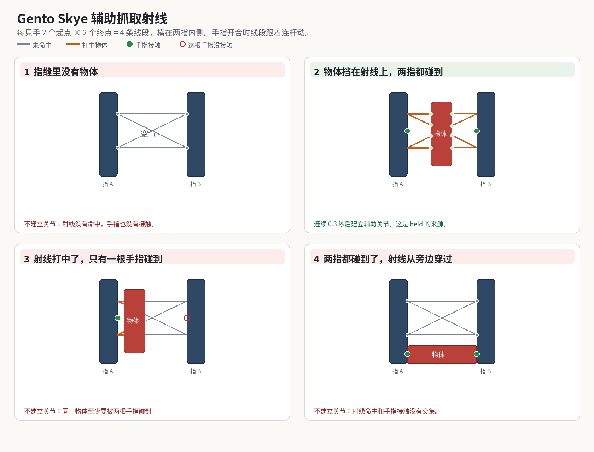

# 怎样判定夹爪抓住了收音机

Gento Skye 在这次 `turning_on_radio` 里用辅助抓取（`grasping_mode: assisted`）。一次尝试算成功，要同时满足两件事：某只手的辅助关节连着的是任务目标（收音机），并且收音机比场景加载时高出至少 10 cm。两项在同一个仿真步成立，成功就锁定，环境在这一步结束。

策略程序读不到这个判定。它运行时能看到的是夹爪开合宽度 `gripper_positions`。宽度说明指间有没有东西，不说明那是不是收音机，也不说明辅助关节建上了没有。成绩以 `outcome.json` 的 `task_success` 和 `evaluation/protocol.json` 为准。

上图是两指之间的正视图。灰线是没有打中物体的线段，橙线是打中物体的那一段，绿点是手指碰撞体接触到物体，红圈是这根手指没有接触。

| 图 | 射线 | 手指接触 | 结果 |
| --- | --- | --- | --- |
| 1 指缝是空的 | 四条线穿过空气 | 没有 | 不建关节 |
| 2 物体挡在四条线上，两指都碰到 | 打中该物体 | 两根都碰到同一物体 | 连续 0.3 秒后建关节，这是 `held` |
| 3 射线打中了，只有一根手指碰到 | 打中该物体 | 只有一根 | 不建关节 |
| 4 两指都碰到了，射线从物体旁边穿过 | 打在空气里 | 两根都碰到，但碰到的位置不在这四条线上 | 不建关节 |

## 1. 一次尝试怎样算成功

见证写在 `src/cap_harness/validation/evaluators/behavior_pickup.py` 的 `BehaviorPickupWitness`。每个仿真步在动作执行成功之后做三件事：

1. 对每只手臂调用 `robot.is_grasping(arm, candidate_obj=目标物体)`。在辅助抓取模式下，这为真当且仅当这只手的辅助关节连着的就是这个物体，并且还没进入松开计时。连着别的物体、或者已经开始松开，都是假。
2. 用目标物体当前高度减去场景加载完成后记下的高度。差 ≥ `0.10` m 记为抬起。5 mm 会在接触的一瞬间结束这一集：seed 26、27、29 和诊断 seed 36 被记成成功的那几次，离地只有 5.7–7.0 mm，视频停在碰撞和碰一下收音机。没抓住时的撞击已经到过约 2 cm。10 cm 高于这些撞击，也落在策略用来抬起的 15 cm 躯干行程里。
3. 同一只手「抓着目标」并且「已经抬起」同时成立，成功锁定。连续步数要求 `DEBOUNCE_STEPS = 0`，所以第一个这样的步就锁定。锁定那一步的手臂记入 `holding_arm`。

`evaluation/protocol.json` 里三个检查的含义不同：

| 字段 | 含义 |
| --- | --- |
| `checks.held` | 这一集里至少有一步，某只手的辅助关节连着目标。松开之后这个标记仍保留。 |
| `checks.lifted` | 目标高度至少有一次超过起点 10 cm。手没抓住、只是抬高了，也会是真。 |
| `checks.held_and_lifted` | 上面两件在同一步成立。这才是 `protocol_success`。 |
| `max_clearance_m` | 整集里高度差的最大值。单独看它不能当进度：手臂把收音机碰起来、并没有抓住时，这个数可以比真正成功的那几次更大。 |
| `first_held_step` / `first_lifted_step` / `success_step` | 三件事第一次发生的步号。 |

`outcome.json` 在见证锁定的那一步写 `task_success: true`，`termination_reason` 为 `task_succeeded`。`program_ok` 只表示程序没报错、也没走到步数上限，不是抓住了。

seed 26 第 13 次是在旧的 5 mm 标准下锁定的：`holding_arm` 是 `left`，第 579 步先抓住，第 594 步高度差到 6.5 mm，环境随即结束。按 10 cm 这不是成功。`lifted` 为真而 `held` 为假，是撞到了收音机，同样不算。

一个 seed 的成绩只看最终那份 `policy.py`：它至少成功过一次，这个 seed 就记为成功。不统计成功率。

## 2. 辅助关节何时建立

`src/cap_harness/behavior/config.py` 里 Gento 的配置是 `grasping_mode: "assisted"`、`grasping_direction: "upper"`。手指关节从 0 增到 0.04 m 是闭合，所以「正在闭合」指关节指令高于下限。

每个物理步，对每只还空着的手，夹爪指令处于闭合时才寻找物体。寻找要同时满足下面几条，并连续保持 `GRASP_WINDOW = 0.3` 秒：

1. 四条辅助射线里至少一条打中该物体（第 3 节）。打在机器人自己身上的命中丢掉。
2. 手指碰撞体也接触到该物体，并且接触来自至少两根手指连杆。`finger_link_names` 左手是 `Arm_L10_Link` 与 `Arm_L11_Link`，右手是 `Arm_R10_Link` 与 `Arm_R11_Link`。
3. 射线命中的物体集合和手指接触的物体集合取交集。多个候选时，留连杆中心离末端原点最近的那个。
4. 该连杆质量不超过 10 kg。超过 10 kg 时，只有固定底座物体上、根连杆以外的连杆还能抓。收音机远轻于这个上限。

四条都成立满 0.3 秒后，在手指与该连杆的接触点建立关节：普通连杆用固定关节，本身还能动的连杆用球关节。关节把物体保持在手上，手移动时物体跟着末端走。`is_grasping` 此后对该物体返回真。

闭合指令取消后进入松开。松开窗口 `RELEASE_WINDOW` 是 1/30 秒，窗口结束时辅助关节拆除，`is_grasping` 变回假。

实现在 OmniGibson 的 `omnigibson/robots/robot.py`：`_handle_assisted_grasping`、`_calculate_in_hand_object`、`_find_gripper_raycast_collisions`、`_maybe_establish_grasp`。射线检测用 `omnigibson/utils/sampling_utils.py` 的 `raytest_batch`，每条线段只保留最近的命中。

## 3. 四条射线怎么定义

射线是两根手指内侧之间的线段，不是相机光。端点写在手指连杆的局部坐标里，单位米。文件是 `behavior-data/omnigibson-robot-assets/models/gento_skye/gento_skye.yaml` 的 `manipulation` 段。

左手：

| 角色 | 连杆 | 局部坐标 |
| --- | --- | --- |
| 起点，两处 | `Arm_L10_Link` | `[0, -0.14, 0.042]`、`[0, -0.18, 0.042]` |
| 终点，两处 | `Arm_L11_Link` | `[0, -0.14, -0.042]`、`[0, -0.18, -0.042]` |

`y = -0.14` 和 `y = -0.18` 是沿手指长度隔开 4 cm 的两个站位。`z = ±0.042` 贴在两指相对的内侧；符号相反，是因为两根连杆的局部 z 朝向相反。每个起点连到每个终点，所以是 4 条线段：两条横跨指缝，两条对角线。图里的叉就是这四条。

右手起点在 `Arm_R10_Link`，数值与左手相同。终点在 `Arm_R11_Link` 上是 `[-0.0013, 1.933, 0.042]` 和 `[-0.0013, 1.973, 0.042]`。`Arm_R11_Joint` 的原点在 y = 1.793 m，并且绕 X 转了 180°，局部 y、z 与左手相反。换回父连杆后，右手指缝和左手对称。

每个物理步用两根连杆当时的位姿，把这 4 个局部点变到世界坐标，再做射线检测。手指开合，线段跟着变短或变长。

因此带子或提手要被算作抓住，几何上要同时落在这两处：它挡在这 4 条线段上，并且两根手指的碰撞体都碰到它。射线穿过了收音机但手指没夹上，或者手指夹到了、四条线段却从旁边空过去，都不会建立关节，`held` 也不会变成真。

## 4. 和策略里夹爪读数的关系

策略在闭合之后读 `get_robot_state().gripper_positions`。在这台夹爪上，读数接近 0 是指间空的，中间值是指间夹着东西，接近 1 是张着或顶住了比开口更宽的部位。seed 36 第 23 次读数从 0.31 掉到 0.001，带子在抬起时滑出，辅助关节没有保持住，那一次 `task_success` 是假。

策略不能读 `is_grasping`、`_ag_obj_in_hand` 或 `evaluation/protocol.json`。它只能用夹爪宽度和腕部画面决定要不要再转 90° 重夹。官方有没有抓住，等这次运行写完 `protocol.json` 再看。
