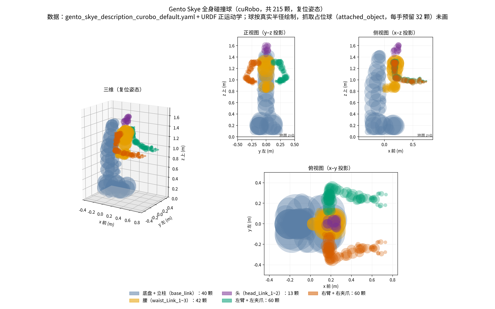
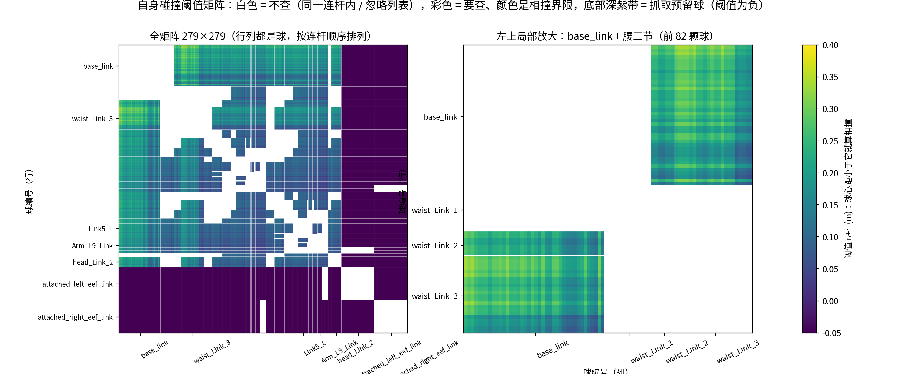
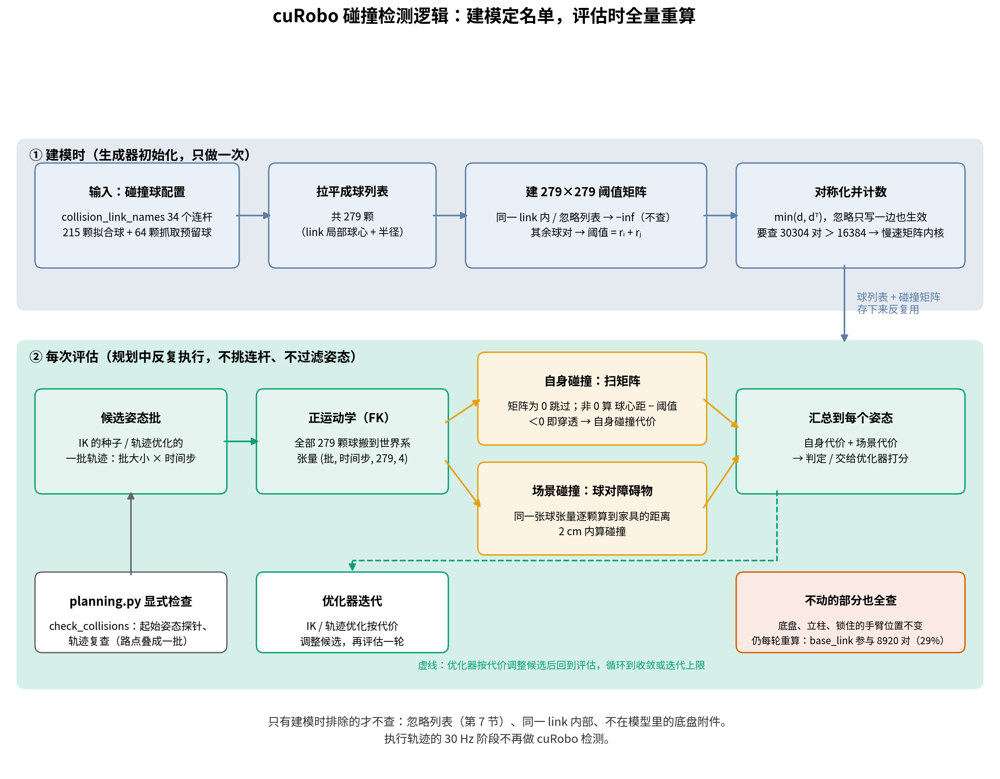

# Gento Skye 的 cuRobo 碰撞球：问题、设计与验证

文档总入口：[gento-skye-README.md](gento-skye-README.md)。

本文记录 2026-10-21 为 Gento Skye 重新设计 cuRobo 碰撞模型的全过程：为什么要改、怎么设计的、怎么验证的、和其他运动规划器有什么区别，以及还没解决的问题。逐次运行的原始输出在 [gento-skye-troubleshooting.md](gento-skye-troubleshooting.md) 第 11 节，这里讲整体的思路和结论。

## 1. 当前状态

| 项 | 导入器生成的原版 | 现在 |
| --- | --- | --- |
| cuRobo 碰撞连杆 | 51 个 | 32 个机器人连杆，另有 2 个抓取物体占位 |
| 碰撞球 | 63 颗，每个连杆 1 颗外接球 | 215 颗，按网格拟合 |
| 手臂、夹爪的近似误差 | 外接球，比实物胖 4–9 cm | 漏覆盖约 1 cm，虚胖不超过约 1.5 cm |
| 复位姿态下的自身重叠 | 8 对以上，最深 66 cm | 0（离线检查） |
| 最低球底离地 | 压进地面 | 3.0 cm |
| 自身碰撞忽略 | 导入器生成，后来手工加了几条有风险的 | 按数据重建，154 条 |

离线检查全部通过。2026-10-21 14:41 在 Isaac 里验证通过（`run-20261021T144134.541951Z-09c1c68c`）：

```text
与场景碰撞: False；含自身碰撞的总判定: False
左手逆运动学（原地）: 有解
左手逆运动学（上抬 5 cm）: 有解
```

bring-up 程序的 `reach_ok` 为真：`move_to_pose` 成功，执行 29 步，末端误差约 7.7 mm。左腕相机画面在抬手后整体下移，手确实抬起来了。

cuRobo 日志确认用的是慢速自身碰撞算法：`Self Collision checks are greater than 32 * 512, using slower kernel. Number of spheres: 279`（215 颗机器人球 + 64 颗抓取预留球）。这次唯一一次规划，`provider.curobo` 用时 3.05 s；`move_to_pose` 连同执行共 8.9 s。

诊断的自身重叠里还列出 `Link2_L/R`↔`waist_Link_3` “重叠 0.0 cm”：两边的球在复位姿态下刚好相切，深度不到 0.05 mm，cuRobo 的总判定是不碰撞。也就是说，肩部和躯干在复位时没有余量，手臂往身体方向收时会先碰到这里。



**图 1：全身碰撞球总览（复位姿态）。** 这就是 cuRobo 眼里的机器人：215 颗球按真实半径绘制，用 URDF 正运动学摆到 `config.py` 的复位姿态（手臂在身前弯曲，所以正视图里双臂向下、向前收，俯视图里双手伸到身体前方约 0.75 m 处）。颜色按部位分组：底盘 + 立柱 `base_link` 40 颗（蓝灰，底部一团大球是底盘，往上的一串是立柱），腰三节共 42 颗（黄），头两节 13 颗（紫），每只手臂连夹爪 60 颗（左绿、右橙）。整体轮廓：球面最低点离地 3.0 cm，最高点约 1.66 m（头顶），左右最宽约 0.83 m（双臂）。可以看到第 5.7 节说的规律——球大量交叠、大球填芯小球补边，底盘和腰部的球明显比手臂的大一圈。抓取占位连杆 `attached_object_*_eef_link` 平时没有球（抓取时每只手填入预留的 32 颗），图里没有画。用 `gento-skye-import/plot_collision_spheres.py` 重新生成（读当前 cuRobo 配置，改了球或复位姿态后要重跑）。

## 2. 背景：cuRobo 和碰撞球

cuRobo 是 NVIDIA 在 GPU 上运行的运动规划库。在 ASPIRE 的 BEHAVIOR 适配器里，它负责三件事：逆运动学（目标位姿 → 关节角）、手臂轨迹规划、底盘导航规划。代码在 `ASPIRE/src/cap_harness/behavior/planning.py`，通过 OmniGibson 的 `CuRoboMotionGenerator` 调用。

cuRobo 不直接用网格判断碰撞，而是给每个连杆挂一组球：

- 两颗球相撞：球心距离小于半径之和；
- 球和场景相撞：球心到障碍物表面的距离小于半径。

判断只需要算距离，GPU 可以同时检查成千上万个候选姿态，这是 cuRobo 快的原因。代价是：**cuRobo 眼里的机器人长什么样，完全取决于球怎么摆。** 仿真画面用的是真实网格，球摆错了，画面上看不出来，规划却会一直失败。

另外两个参数：

- cuRobo 把离障碍物 2 cm 以内都算作碰撞（`planning.py` 的 `COLLISION_ACTIVATION_DISTANCE_M = 0.02`）；
- `collision_sphere_buffer` 是 0.002，即所有球在和场景比较时再加大 2 mm。

配置文件位置：

```text
behavior-data/omnigibson-robot-assets/models/gento_skye/curobo/
  gento_skye_description_curobo_default.yaml    全身（底盘 + 腰 + 双臂）
  gento_skye_description_curobo_arm.yaml        手臂规划（move_to_pose 用这个）
  gento_skye_description_curobo_arm_no_torso.yaml
  gento_skye_description_curobo_base.yaml       底盘导航
```

四份的碰撞部分完全相同。导入配置 `gento-skye-import/gento_skye_source_config.yaml` 的 `curobo` 段是它们的来源：导入器按 `collision_spheres` 的键生成碰撞连杆列表，所以两边都要改，否则重新导入会改回去。

## 3. 原来的问题

### 3.1 每个连杆只有一颗外接球

导入器给每个连杆生成一颗刚好包住整个连杆的球。连杆越长、越扁，球比实物胖得越多：

| 连杆 | 实物尺寸 | 原来的球 | 多出来的 |
| --- | --- | --- | --- |
| `base_link`（底盘 + 立柱） | 68 × 55 × 147 cm | 1 颗，半径 0.735 m | 把整台机器人包在里面 |
| `waist_Link_3`（上半身） | 29 × 28 × 46 cm | 1 颗，直径 0.46 m | 两侧各约 9 cm |
| `Link5`（前臂） | 9 × 12 × 22 cm | 1 颗，直径 0.22 m | 两侧各约 6 cm |
| `Link2`（肩部） | 12 × 21 × 13 cm | 1 颗，直径 0.21 m | 前后各约 4 cm |
| 轮子 `*L_Link` | 直径 14 cm | 半径 0.07 m，球心在轮轴 | 球底正好贴地 |

结果是：腰和两只手臂永远埋在 `base_link` 那颗大球里，右侧轮子永远“撞”地板。任何 `move_to_pose` 都是 `IK Fail`。

### 3.2 怎么查出来的

`planning.py` 里加了 `diagnose_current_configuration()`，运行时设置 `GENTO_PLAN_DIAG=1`（或停窗口的 `GENTO_HOLD=1`），复位后在终端打印以 `GENTO_PLAN` 开头的诊断：

- 和场景是否碰撞、是哪几个连杆；
- 自身重叠最深的连杆对；
- 关节是否贴近或超出限位；
- cuRobo 算出的末端位置和仿真相差多少；
- 左手在原地、上抬 5 cm 两个目标能否求出逆解。

第一次诊断的关键行：

```text
与场景碰撞的连杆: YQL_Link, YHL_Link
  base_link <-> waist_Link_2  重叠 66.1 cm
  base_link <-> waist_Link_3  重叠 50.5 cm
  Link3_R <-> base_link  重叠 34.7 cm
正运动学 left_eef_link: cuRobo 与仿真相差 0.0 cm
```

运动学一致，问题只在球。

## 4. 为什么不能靠“忽略”解决

第一轮只换了 `base_link` 和轮子的球，又出现 `Link2`↔`waist_Link_3`、`Link5`↔`Link7`、夹爪各部件之间的重叠。我当时的做法是把这些连杆对加进 `self_collision_ignore`，让 cuRobo 不再检查它们。

这样做有两个问题，第二个是你指出来的：

1. 一部分重叠只是球太胖，零件实际并没有碰在一起。正确的做法是把球改准，而不是不检查。
2. 被忽略的连杆对里，有些在真实动作中确实会撞上：降低高度并弯腰时，躯干会碰到底盘；肩部 `Link2` 也可能碰到躯干。忽略之后，cuRobo 就不会阻止这些碰撞。

所以最终方案是：先把每个连杆的球拟合准，再只忽略有依据的连杆对，依据见第 7 节。

`self_collision_buffer`（每个连杆单独的半径修正值，只用于自身碰撞检查）在讨论里也考虑过。它适合球已经贴合外形后做小幅调整，比如加 1 cm 安全余量；补不了“一颗球胖 9 cm”这种问题。现在设的是空的。

## 5. 拟合方法

工具：`gento-skye-import/fit_collision_spheres.py`。

### 5.1 生成单位：逐个 link，各拟合各的

**是的，球是靠各个 link 生成的：一个 link 一组球，逐个独立拟合，互不参照。** 不是把整台机器人当一个整体拟合，也不是按关节、按部位（手臂/躯干）或按姿态生成。具体流程：

```text
cuRobo 配置的 collision_link_names（32 个机器人连杆）
  └─ 逐个 link：找 meshes/**/<link>.STL（文件名和连杆同名）
       └─ 在这个 link 自己的坐标系里拟合（5.3、5.4 节）
            └─ 输出一组球：[{center: [x, y, z], radius: r}, ...]，坐标都是 link 局部坐标
  └─ 汇总成 fitted_collision_spheres.yaml（link 名 → 球列表）
       └─ apply_collision_spheres.py 写回 4 份 cuRobo 配置和导入配置
```

要点：

- **哪些 link 有球，由清单决定。** 清单是 cuRobo 配置的 `collision_link_names`，共 32 个：`base_link` 1 个、腰 3 个、头 2 个、每侧手臂 13 个（`Link1`–`Link8`、`TCP_Link`、腕部标记、`Arm_*9/10/11_Link`）。拟合脚本就是遍历这份清单（`fit_collision_spheres.py` 的 `links`），清单之外的连杆——移出碰撞模型的 19 个底盘附件（第 6 节）、装在外壳里的传感器连杆——不拟合、没有球。两个抓取占位连杆 `attached_object_*_eef_link` 在清单里但不拟合，它们用 `extra_collision_spheres` 预留的每手 32 颗，抓取时才填。
- **坐标在 link 局部系里，所以和姿态无关。** 拟合时不输入任何关节角，STL 本来就在 link 坐标系下，输出的球心也记在同一系里。运行时 cuRobo 沿关节链做正运动学，把每组球随它所属的 link 一起变换到世界系，半径不变；某个关节动，只有它下游 link 的球跟着动。一套球因此适用于所有姿态，不需要在不同姿态下重新生成。
- **球数不是预先按尺寸算好的，是贪心覆盖“长”出来的。** 每个 link 的球数由它的形状复杂度、容差/虚胖参数和球数上限共同决定（5.4、5.5 节）：覆盖达标就停，达到上限也停。上限默认 48 颗、`base_link` 40 颗，实际结果从 `Link6` 的 1 颗到 `base_link` 的 40 颗不等。（脚本里有个按包围盒估球数的 `sphere_count()` 函数，写了但没有被调用，球数不由它决定。）
- **左右是分开拟合的。** 左、右手臂的对应 link 各自加载自己的 STL、各跑一遍贪心，所以球数和球位不完全镜像（5.7 节）。
- **例外不走拟合。** `TCP_Link_*` 的网格是零尺寸的坐标标记，保留导入器那颗 1 cm 的球；`base_link` 拟合后多一步贴地压半径（5.4 节第 6、7 条）。
- **相邻 link 之间会不会重叠，不归生成管。** 每组球只对自己 link 的表面负责，拟合时根本不知道邻居长什么样、关节转到哪。link 之间的事——复位/随机姿态下检查重叠、决定哪些连杆对不查——是拟合之后 `check_collision_spheres.py` 和忽略列表做的（第 7、9 节）。所以顺序不能反：先逐 link 把球拟合准，再处理 link 间关系（第 4 节）。

### 5.2 为什么不用 cuRobo 自带的拟合

cuRobo 有 `curobo.geom.sphere_fit.fit_spheres_to_mesh`。试过之后，很多连杆的漏覆盖有 5–20 cm（网格表面有些地方离最近的球还差这么远），而且经常报 “only got k/n samples”，生成的球数不够。这样的球比原来的外接球还危险，会漏掉真碰撞。

### 5.3 网格本身的问题

Gento 的 STL 大多是多块零件拼起来的开口外壳：

| 连杆 | 封闭 | 零件块数 | 法向朝外比例 |
| --- | --- | --- | --- |
| `Link5_L` | 否 | 16 | 72% |
| `waist_Link_3` | 否 | 24 | 52% |
| `base_link` | 否 | 19 | 53% |
| `Link6_L` | 是 | 1 | 98% |

在这种网格上判断“点在不在里面”不可靠。第一版拟合因此把候选球心放到了网格外面，虚胖测出来有 7–9 cm。

### 5.4 现在的做法

1. **实体近似。** 把网格拆成独立零件，每块取凸包，用这些凸包的并集当实体。凸包一定封闭、法向朝外。外壳里的空腔会被当成实心，这对碰撞检查正合适，空腔里本来也放不进别的东西。由多块零件拼成的 L 形等外形仍能保留，不会被一个大凸包整体包掉。
2. **表面采样。** 在并集的外表面上取 8000 个点，被别的凸包盖住的点不算外表面。
3. **候选球心。** 实体内部的网格点，加上从表面沿法向往里推 0.4、0.8、1.5、3 cm 的点（照顾薄零件）。
4. **候选半径。** 球心到最近表面点的距离，加上允许的虚胖。这样每颗球最多只伸出实物约“虚胖”那么多。
5. **贪心覆盖。** 每次挑一颗能把最多表面点拉进容差范围的候选球，直到所有表面点离最近的球都不超过容差，或者达到球数上限。
6. **底盘贴地处理。** `base_link` 坐标系的 z = 0 就是地面（轮轴高 0.07 m，轮半径 0.07 m）。每颗球的半径压到“球心高度 − 3 cm”，半径小于 1 cm 的球直接去掉。
7. **退化网格。** `TCP_Link_*` 的网格尺寸是 0（只是坐标标记），保留原来那颗 1 cm 的球。

### 5.5 参数

| 部分 | 容差（漏覆盖） | 允许虚胖 | 球数上限 | 理由 |
| --- | --- | --- | --- | --- |
| 手臂、夹爪、腰第二节、头第一节 | 1 cm | 1.5 cm | 48 | 默认：靠近手和物体，精度最重要 |
| 上半身 `waist_Link_3`、头 `head_Link_2` | 1.5 cm | 1.5 cm | 48 | 离指尖较远 |
| 腰板 `waist_Link_1_prismatic` | 2 cm | 1.5 cm | 48 | 一块 28 × 11 × 16 cm 的板子，1 cm 精度要 26 颗 |
| 底盘 `base_link` | 3 cm | 2 cm | 40 | 离手最远；球数对计算量影响最大（见第 8 节） |

“漏覆盖”和“虚胖”都是对着凸包并集量的：前者是表面上离最近的球最远的那个点有多远，后者是球面伸出实体多远。

### 5.6 结果

| 连杆 | 球数 | 半径范围（m） | 漏覆盖 | 虚胖（95%） | 虚胖（最大） |
| --- | --- | --- | --- | --- | --- |
| `base_link` | 40 | 0.041–0.199 | 5.6 cm | 2.1 cm | 3.4 cm |
| `waist_Link_1_prismatic` | 13 | 0.021–0.065 | 2.0 cm | 1.4 cm | 1.5 cm |
| `waist_Link_2` | 7 | 0.061–0.096 | 1.1 cm | 1.3 cm | 1.5 cm |
| `waist_Link_3` | 22 | 0.018–0.144 | 1.6 cm | 1.5 cm | 2.1 cm |
| `Link1` | 8 | 0.025–0.059 | 约 1 cm | 1.4 cm | 1.5 cm |
| `Link2` | 10 | 0.018–0.064 | 约 1 cm | 1.4 cm | 1.6 cm |
| `Link3` | 8 | 0.032–0.051 | 1.0 cm | 1.3 cm | 1.5 cm |
| `Link4` | 5 | 0.045–0.063 | 0.9 cm | 1.3 cm | 1.5 cm |
| `Link5` | 9 | 0.022–0.053 | 约 1 cm | 1.4 cm | 1.5 cm |
| `Link6` | 1 | 0.045 | 0.6 cm | 1.0 cm | 1.5 cm |
| `Link7` | 4 | 0.045 | 约 1 cm | 1.4 cm | 1.5 cm |
| `TCP_Link` | 1 | 0.010 | — | — | — |
| `Link8` | 3 | 0.030–0.037 | 0.9 cm | 1.4 cm | 1.5 cm |
| 腕部 `Link_*_wrist` | 1 | 0.018 | 0.9 cm | 1.4 cm | 1.5 cm |
| `Arm_*9_Link` | 4 | 0.019–0.044 | 1.0 cm | 1.4 cm | 1.6 cm |
| 手指 `Arm_*10/11_Link` | 3 | 0.016–0.025 | 约 1 cm | 1.5 cm | 1.6 cm |
| `head_Link_1` | 3 | 0.045–0.059 | 1.0 cm | 1.3 cm | 1.5 cm |
| `head_Link_2` | 10 | 0.024–0.066 | 1.4 cm | 1.4 cm | 1.5 cm |

手臂各连杆左右对称，表里只列一侧。`base_link` 的漏覆盖 5.6 cm 出现在贴地部分：为了保证离地 3 cm，那里的球被压小了。底盘底面不会和手臂发生碰撞，地面以上的部分在 3 cm 左右。

`base_link` 需要 40 颗，是因为它是 68 × 55 cm 的底盘加 1.47 m 的立柱。立柱截面只有 18 × 25 cm，球半径大不了，只能排一长串；底盘四周还有凸起、凹槽和贴地部分要盖住。

### 5.7 球具体怎么分布，为什么

所有坐标都在各连杆自己的坐标系里（单位 m），和 URDF 的 `<collision>` 一致：这些连杆碰撞网格的 origin 都是单位变换。完整的 215 颗球列在附录 A。

**总规律：大球填芯，小球补边角。** 贪心覆盖每一步都选“能把最多表面点拉进容差”的那颗球。内部离表面远的点，半径大、一次盖住的面积也大，所以先被选中；剩下没盖住的通常是棱角、凸起和细长的部分，于是用小球补。

这样做的后果有三个：

- 球大小差别很大：同一个连杆里，最大和最小的半径可以差 3 到 10 倍；
- 排布不对称：左右手臂对应连杆的球数可能差一两颗，位置也不完全镜像；
- 球之间大量重叠：相邻两颗球通常交叠一半以上，这样表面才连续，不会在球与球之间留出缝。

这种排布和手工“沿轴线等距排一串等大的球”不同。手工排布整齐，但在长方形截面的连杆上，要么棱角盖不住，要么为了盖住棱角整体变胖。

**底盘 `base_link`（40 颗）**

| 高度段（z，m） | 球数 | 半径 | 位置 | 作用 |
| --- | --- | --- | --- | --- |
| 0.09–0.23 | 15 | 0.06–0.20 | x −0.28…0.20，y −0.20…0.22 | 底盘主体。核心是 10 颗半径 0.16–0.20 的大球，前后三列、左右两行；四周边缘和贴地处是半径 0.06–0.12 的小球 |
| 0.29–0.37 | 2 | 0.10–0.15 | 靠后（x ≈ −0.20…−0.24） | 底盘和立柱之间的过渡 |
| 0.47–1.43 | 23 | 主列 0.11–0.15，补角 0.04–0.09 | 主列 1.0 m 以下多在 x ≈ −0.10 和 −0.20 两条线上，1.0 m 以上收到 −0.08…−0.14；y ≈ 0；补角 x ≈ −0.02，y ≈ ±0.10 | 立柱 |

为什么这样排：

- 底盘是 68 × 55 × 36 cm 的扁盒子，高度只有 36 cm，所以大球的半径不能超过 0.2 m 左右。球心都在 0.19–0.23 m 高度上：半径越大，球心越靠上，才能保证球底离地至少 3 cm。贴地的边缘只能放小球，这是底盘漏覆盖最大（5.6 cm）的地方。
- 立柱在网格里是一整块零件。它的凸包是 x −0.327…0.021、y ±0.135、z 0.11…1.51 的楔形：0.9 m 以下前后深约 35 cm，1.1 m 处约 29 cm，1.3 m 处约 23 cm。所以 1.0 m 以下要用前后两条线的球（x ≈ −0.10、−0.20）才能盖住深度，往上变浅，就收成一列。
- 立柱前侧的两个棱角（滑轨在那里）离中轴远，主列盖不到，用半径约 5 cm 的小球补。

**立柱这里有一处误差没有体现在“虚胖”里。** 立柱后面 0.9 m 高处有一个向后的凸起（网格 x 到 −0.327），取凸包时，这个凸起和立柱之间的凹处被整块填实了。“虚胖”是对着凸包量的，所以看不出来；对着真实网格，立柱后方最多胖出约 15 cm。手臂很少伸到立柱后方，影响不大；需要更准时，可以用 V-HACD 把立柱零件拆成几个凸块再拟合。环境里已有 `vhacdx`，`trimesh.decomposition.convex_decomposition` 可以直接调用。手臂、躯干等其他连杆的零件本身接近凸形，没有这么大的填实误差，但凡是凹形零件，都有同类误差。

**上半身 `waist_Link_3`（22 颗）**：网格 z 0.10–0.56 m，宽 29 × 28 cm。上部（z 0.40–0.50）有 12 颗，因为两侧是肩部安装座，最宽（y ±0.13）；下部窄，只有 1–3 颗半径 0.10–0.14 的大球。球心都在 z 0.50 以下，最顶上的一圈靠大球的上半部分盖住。

**腰板 `waist_Link_1_prismatic`（13 颗）**：一块 28 × 11 × 16 cm 的板，沿长轴（x）排了一串半径约 0.06 的球，x 从 −0.15 到 0.03，每隔约 2 cm 一颗，在 z 方向上下错开。板厚只有 11 cm，所以球不能大；两端各用一颗 2–3 cm 的小球补角。

**腰第二节 `waist_Link_2`（7 颗）**：接近立方体（18 × 18 × 26 cm），上下各两三颗半径 0.08–0.10 的大球，中间两侧各一颗 0.06 的补宽。

**手臂（每节 1–10 颗）**：每节都是“两端关节外壳 + 中间连接段”的形状。球心沿长轴排成一串，两端关节处的球大（半径 0.045–0.064），中间细的地方小。例如：

- `Link2`（肩，长轴 y，长 20 cm）：y = −0.007、0.013（肩关节外壳，半径 0.054–0.064），0.053、0.093（中段，0.057–0.058），0.113（远端关节，0.048–0.051），外加一颗 0.018 的补角；
- `Link5`（前臂，长轴 z，长 22 cm）：z = −0.17、−0.15（远端，0.045–0.051），−0.09（中段两颗 0.053，左右并排），−0.025（近端三颗 0.045）；
- `Link4`（肘，5 颗）：沿 y 从 −0.09 到 −0.01，半径从 0.045 增大到 0.063，肘关节外壳最粗；
- `Link6`（7.7 × 6.6 × 9 cm，接近球形）：1 颗，半径 0.045，球心在原点；
- `Link7`（4 颗）：半径都是 0.045，沿 y 从 −0.065 到 0.004。

**夹爪**：`Arm_*9_Link`（手掌座）4 颗，中间一颗 0.044，三个角各一颗约 0.02；每根手指 3 颗，半径 0.016–0.025，沿手指长度（y −0.19…−0.12）排列，在手指张开的位置上拟合。`TCP_Link` 只是坐标标记，保留 1 颗 1 cm 的球。

**头部**：`head_Link_1`（颈）3 颗，沿 z 排列；`head_Link_2`（头壳）10 颗，半径 0.024–0.066，铺满头壳，前脸（x 0.06–0.09）的球最密。

## 6. 底盘附件移出碰撞模型

四个轮子（`ZQL/YQL/ZHL/YHL_Link`）、四个转向叉（`ZQ/YQ/ZH/YH_Link`）、两个悬挂（`ZLD/YLD_Link`）、八个脚轮（`C1`–`C8_Link`）和 `XJ_Link`，共 19 个连杆，从 cuRobo 的碰撞模型里去掉了：

- 它们的关节不在 cuRobo 的 29 个规划关节里，规划时一动不动，和底盘是一体的；
- 它们在底盘下面，对地面和家具的避碰由 `base_link` 的球负责；
- R1 Pro 的 cuRobo 配置里，轮子也没有碰撞球。

这一步让需要检查的连杆对从 1021 降到 432。

## 7. 自身碰撞忽略列表

cuRobo 的 `self_collision_ignore` 是“这个连杆和哪些连杆不做自身碰撞检查”。cuRobo 按连杆逐个读，最后对矩阵取 `min(d, dᵀ)`，所以一对只要写在其中一边就生效。

重建后只允许四类，由 `apply_collision_spheres.py` 自动生成：

1. **URDF 里直接父子相连的连杆。** 关节处的零件本来就挨着。
2. **刚体组内部。** 按 URDF 关节类型自动分组：固定关节，或者 cuRobo 锁住的关节（四个手指关节、底盘的 z/rx/ry），把连杆归成刚体组。组内连杆相对位置永远不变，不可能互撞。Gento 有三组：
   - 底盘组 12 个：`base_link`、两个悬挂、八个脚轮、`XJ_Link`（移出碰撞模型后只剩 `base_link`）；
   - 左手腕组 7 个：`Link7_L`、`TCP_Link_L`、`Link8_L`、`Link_Left_wrist`、`Arm_L9_Link`、`Arm_L10_Link`、`Arm_L11_Link`；
   - 右手腕组同理。

   检查脚本核对过：组内每一对都在忽略列表里，漏掉的是 0。
3. **实测在所有姿态下都贴合的。** 用拟合后的球，在关节限位内随机采样，在 100% 的姿态里都重叠的：
   - `Link5`↔`Link7`：球只胖 1.5 cm 时仍然重叠，最深 8.5 cm。两节手腕外壳本来就嵌在一起，R1 Pro 也忽略 `left_arm_link5`↔`left_arm_link7`；
   - `waist_Link_1_prismatic`↔`waist_Link_3`：最深 0.9 cm，在球的虚胖误差内，任何姿态下都不会真撞上。
4. **采样中从未靠近的。** 在关节限位内随机采样 1 万个姿态，其中四分之一把各关节推到限位两端。两个连杆之间的球面距离始终大于 5 cm，就判定它们在运动学上不可能相撞。这和 MoveIt 配置助手的 “never in collision” 是同一做法。5 cm 是 cuRobo 判碰撞距离（2 cm）的 2.5 倍。

**撤掉的忽略**（恢复检查）：`base_link`↔`waist_Link_2`、`base_link`↔`waist_Link_3`、`waist_Link_3`↔`Link2_L`、`waist_Link_3`↔`Link2_R`。在新的球下，它们复位时不重叠。

**两只手臂之间：** 只有 `Link1`–`Link4`（肩部和大臂）互相忽略，它们分在躯干两侧，采样中从未靠近。前臂、手腕、夹爪之间的所有组合都在检查，两只手在身体前方交叉时 cuRobo 能挡住。

**抓取物体：** `attached_object_*_eef_link` 和同侧两根手指之间的忽略原样保留（来自导入器）。

## 8. 连杆对和球对

- **连杆对**：哪两个零件之间要检查碰撞。忽略列表按连杆对写。
- **球对**：实际要算多少次球与球的距离。一个连杆对展开后，是两边球数相乘。例如 `base_link`（40 颗）对 `Link2_L`（10 颗）是 1 个连杆对、400 个球对；`Link6_L`（1 颗）对 `Link4_R`（5 颗）是 1 个连杆对、5 个球对。

**本节名词先说清：**

| 名词（代码里的名字） | 是什么 |
| --- | --- |
| 阈值矩阵（`self_collision_distance`） | 279×279 的表，行和列都是球，格子存“这两颗球的球心距小于多少算相撞”，即两半径之和；不查的格子存 −inf。详见 8.1 和图 2 |
| −inf | “负无穷”，矩阵里的占位值，意思就是“这一对永远不用算”。运行时它会被转成碰撞矩阵里的 0 |
| 碰撞矩阵（`collision_matrix`） | 由阈值矩阵转成的 0/1 表：−inf 变 0（跳过），其余变 1（要算）。慢速内核运行时实际扫的是它；相撞界限则由球张量里两颗球的半径现场相加，两者等价 |
| 对称化（`min(d, dᵀ)`） | dᵀ 是矩阵转置（行列互换）。取逐格较小值后，矩阵沿对角线对称，于是忽略只写一边、另一边自动同样生效 |
| 快速 / 慢速内核（kernel） | 在 GPU 上算球对距离的两种程序：快速版用预排的球对清单，要查的球对 ≤ 32×512=16384 时可用；慢速版逐格扫碰撞矩阵，慢但不限量。内核就是 GPU 上被成千上万个线程并行执行的那个函数 |
| 球张量（`robot_spheres`） | 一批姿态下全部球的世界坐标，打包成形状（批大小， 时间步， 279， 4）的数组，最后一个 4 是球心 x、y、z 加半径。张量就是多维数组 |
| 批大小 × 时间步（batch × horizon） | 批大小：一次同时评估多少条候选轨迹；时间步：一条轨迹离散成多少个姿态点。两者相乘就是一次内核调用要判定的姿态总数 |
| 候选姿态 | 规划器正在试的一个关节角组合（一条轨迹就是一串候选姿态）。规划就是生成很多候选、逐个判定、挑不撞又够得着的 |
| 正运动学（FK，forward kinematics） | 由关节角算每个连杆（连带它的球）在世界系的位置和朝向。与之相对的逆运动学（IK）是给末端位置反求关节角 |
| 碰撞代价（cost） | 把“穿透多深”汇总成的一个数：不撞是 0（或负），撞得越深越大。优化器靠它打分、把候选往不撞的方向推。它不是真假判定，而是可比较大小的分数 |
| `check_collisions` | cuRobo 提供的“给定一批姿态、回答撞没撞”的现成函数，`planning.py` 用它做起始姿态探针和轨迹复查 |
| 激活距离（`collision_activation_distance`，2 cm） | 只对场景碰撞：球离障碍物表面 2 cm 以内就开始算代价（还没真碰上就先“预警”），让轨迹提前绕开。自身碰撞没有这个距离，直接按球面重叠算 |
| `collision_sphere_buffer` / `self_collision_buffer` | 两个半径修正量：前者（现在 0.002）把所有球加大 2 mm，主要作用于场景碰撞；后者（现在是空的）是每个连杆单独的修正，只用于自身碰撞（第 4 节） |
| 抓取预留球（`extra_collision_spheres`） | 每只手预留的 32 颗占位球，建模时就占好位置（半径先记 −10 表示禁用），抓到物体后把物体的球填进去，规划时就能躲开手里的东西 |

cuRobo 的自身碰撞有两套算法（`cuda_robot_generator.py` 的 `_create_self_collision_thread_data`）：需要检查的球对不超过 32 × 512 = 16384 时，用快速算法；超过时，自动换成基于碰撞矩阵的慢速算法，结果一样正确，只是慢；超过 512 × 1024 时报错。

**更正：** 我之前说写回后需要检查的球对是 15904、在快速算法以内，这是漏算的。每只手在 `extra_collision_spheres` 里预留了 32 颗球，抓住物体时用来表示手里的物体；它们在 cuRobo 建模时就分配好了，也计入球对。加上之后是 **30304**，其中 14400 来自这 64 颗预留球。所以现在用的是慢速算法。慢多少，要等实际运行看规划耗时（`outcome.json` 的 `timing.buckets.provider.curobo`）。

### 8.1 检测逻辑：建模时定名单，每次评估全量重算

分两个阶段，名单只在建模时定一次，运行时不再挑：

1. **建模时（生成器初始化，做一次）。** 279 颗球（215 颗拟合球 + 64 颗抓取预留球）拉成一张列表，再建一张 279 × 279 的阈值矩阵（`cuda_robot_generator.py` 的 `_build_collision_model`）：同一连杆内部的球对、忽略列表里的连杆对，阈值记为 −inf（不查）；其余球对的阈值是两颗球的半径之和（`self_collision_buffer` 现在是空的；`collision_sphere_buffer` 给半径加的那 2 mm 在自身阈值里被等量扣回，只实际作用于场景碰撞）。最后对矩阵取 `min(d, dᵀ)` 对称化，所以忽略只写一边就生效（第 7 节）。球对数 30304 就是这张矩阵里上三角非 −inf 的个数。抓取预留球平时半径是 −10（禁用状态，永远算不出碰撞），但它们的矩阵格子不是 −inf，内核照样要扫过、算过——14400 个球对的开销在没抓东西时也在付。
**阈值矩阵到底是什么。** 把 279 颗球编号 0–278（顺序就是 `collision_link_names` 里连杆的顺序，同一连杆的球排在一起），矩阵第 i 行第 j 列存球 i 和球 j 的相撞界限 = rᵢ + rⱼ：运行时只要这两颗球的球心距小于这个数，就判它们相撞，差多少就是穿透多深。举例：`base_link` 第 13 颗球半径 0.199 m，`Link2_L` 最大的球 0.064 m，格子就是 0.263 m——两球心近于 26.3 cm 即算撞。不查的格子（同一连杆内部、忽略列表）存 −inf。全矩阵 279² = 77841 个格子，去掉对角线和重复的下半，独立球对共 38781 个，其中 30304 个要查、8477 个跳过。它沿对角线对称（i 对 j 和 j 对 i 是同一回事），所以图上以对角线镜像。数据量很小（279×279 个小数），贵不在存它，而在每个候选姿态都要按它算一遍距离。



**图 2：阈值矩阵长什么样（真实数据）。** 左图行列都是球（按连杆分组，细白线是连杆分界）：大片白色是跳过的球对——对角线上的白块是“同一连杆内部不查”，离对角线远的白块是忽略列表和从未靠近的连杆对；彩色格子是要查的球对，颜色越黄界限越大（两颗球越大，离得越远就算撞）；底部和右侧的深紫带是 64 颗抓取预留球，阈值为负（半径 −10），永远算不出碰撞，但格子不是 −inf，内核仍要扫。右图放大左上角（`base_link` + 腰三节共 82 颗）：`base_link`↔`waist_Link_1_prismatic` 整块白色（父子忽略），而 `base_link`↔`waist_Link_2/3` 是彩色的——这正是 8.2 节说的、每轮都要重算的那部分。用 `gento-skye-import/plot_threshold_matrix.py` 重新生成。

2. **每次评估时（规划中反复执行）。** 先对整批候选姿态做正运动学，得到形状为（批大小 × 时间步 × 279 × 4）的世界系球张量（球心 xyz + 半径）；然后慢速内核拿碰撞矩阵逐姿态扫描：矩阵为 0 的球对跳过，非 0 的算球心距离减阈值，小于 0 就是穿透，汇总成这个姿态的自身碰撞代价。场景碰撞是另一条并行路径：同一张球张量逐颗对场景障碍物算距离，2 cm 内算碰撞（第 2 节）。IK 和轨迹优化的每一轮迭代都要对整批候选各做一遍这两条路径；`planning.py` 另外还显式调 `check_collisions`（起始姿态探针、轨迹逐点复查时把所有路点叠成一批一次查完）。执行轨迹时不再查 cuRobo，仿真器只管按关节目标走。



**图 3：碰撞检测流程。** 上半（蓝）是建模时只做一次的事，下半（绿）是规划中每轮评估都全量重做的事；右下红框是 8.2 节的要点——底盘、立柱这类不动的部分不在建模时排除，就会被每轮重算。用 `gento-skye-import/plot_collision_check_flow.py` 重新生成。

### 8.2 不动的部分（底盘、立柱）每次也查吗

**查。cuRobo 没有“这个连杆没动就跳过”的增量优化**：自身碰撞内核的输入只有整张球张量（`SelfCollisionCost.forward`），不知道、也不关心哪些连杆动了。所以：

- 只要一对连杆没进忽略列表，哪怕在本次规划里相对静止，也对每个候选姿态重新算一遍。例如手臂规划时底盘、腰被锁住，`base_link`↔`waist_Link_3`（880 个球对）、`base_link`↔不参与动作的那只手臂、头部各连杆之间的球对，全都每轮重算。`base_link` 一个连杆就参与 8920 个被查球对，占全部 30304 的 29%；它只和 `waist_Link_1_prismatic`（父子，520 个球对）、`head_Link_1`（从未靠近，120 个）在忽略列表里。
- 真正省掉的只有建模时就排除的：忽略列表里的连杆对（第 7 节四类）、同一连杆内部的球对，以及根本不在碰撞模型里的 19 个底盘附件（第 6 节）。这些连运行时扫都不会扫到。
- 场景碰撞同理：手臂规划时底盘不动，但 `base_link` 的 40 颗球对家具的距离每轮还是全算。这不算纯浪费——场景障碍物会随 `update_obstacles` 更新，机器人本体位姿也可能变——但 cuRobo 不为“底盘没动”做任何缓存。

换句话说，这套检测是**每次全量、靠 GPU 并行摊薄**，不是靠跳过静态部分省时间。好在批量一大，单个姿态的成本很低（8.3 节）。

### 8.3 每次检测大约多快

“每次”分三个层级，量级差得很远（2026-10-21 在本机 RTX 4090 上实测，脚本 `gento-skye-import/bench_self_collision.py`，用真实球和忽略列表搭出 279 颗球的慢速内核，只测自身碰撞内核，不含正运动学、场景碰撞和优化器开销）：

| 层级 | 形状 | 耗时 | 折合每个姿态 |
| --- | --- | --- | --- |
| 单个姿态查一次（`check_collisions` 的量级） | 1 × 1 | 约 1.2–1.6 ms | 约 1.2–1.6 ms |
| 一小批候选 | 1 × 32 | 约 3.0–3.8 ms | 约 95–120 µs |
| 一批轨迹候选 | 8 × 32 | 约 3.3–4.0 ms | 约 13–16 µs |
| 大批量 | 32 × 32 = 1024 个姿态 | 约 3.3–4.1 ms | 约 3–4 µs |

小批量时耗时主要花在内核启动和扫 279 × 279 矩阵上，批量越大 GPU 并行摊得越薄——这也是 cuRobo 敢每次全量重算的原因。对照：离线 CPU 版（`check_collision_spheres.py` 的逻辑，15904 个球对、不含正运动学）在本机约 4.2 ms/姿态，且没法批量摊薄。

一次**完整规划调用**（IK + 轨迹优化，内部含成百上千次上面的批量评估，再加场景碰撞、正运动学和 Python 开销）是秒级：第 1 节那次验证 `provider.curobo` 3.05 s/次；汇总 `outputs/` 里 68 份 `outcome.json` 共 2229 次调用，每次中位约 4.1 s，调用密集的运行稳定在约 2 s/次；进程内第一次调用还要建生成器（建阈值矩阵、编译内核），单次可达几十秒。所以“检测慢”体现在规划总时长里，而不是单次球对判定上；执行阶段（30 Hz 控制）不做 cuRobo 检测，没有每步开销。

### 8.4 球对太多时怎么降

如果规划太慢，可以这样降（按当前配置实算，起点 30304）：

| 办法 | 结果 | 减少 | 代价 |
| --- | --- | --- | --- |
| 抓取预留球从每只手 32 颗减到 16 颗 | 22848 | 7456 | 抓住的物体用更少的球表示，形状更粗糙 |
| 预留球和同侧手腕组、`Link5`、`Link6` 之间也忽略 | 28832 | 1472 | 物体贴着手腕时不检查；抓取时它本来就贴着 |
| `base_link` 从 40 颗放宽到 25 颗 | 26959 | 3345 | 底盘、立柱误差变大 |
| 前两条组合 | 22112 | | |
| 三条全部组合 | 19247 | | 仍高于 16384 |
| 预留球减到每只手 8 颗，加第二条 | 18944 | | 仍高于 16384，物体形状很粗 |

结论：在保留现在手臂精度的前提下，靠这些办法回不到快速算法以内。要回去，只能大幅减少手臂或躯干的球，牺牲第 5 节的精度。快速、慢速两种算法的结果一样正确，所以建议先看实际规划耗时；只有确实慢到影响任务时再处理，而且优先做预留球那两条。

## 9. 离线验证

工具：`gento-skye-import/check_collision_spheres.py`。不需要 GPU，用 `yourdfpy` 按 URDF 算正运动学，再逐对计算球与球的距离。

检查项：

1. 需要检查的球对数（不含抓取预留球，见第 8 节）；
2. 复位姿态（`config.py` 的 `RESET_JOINT_POSITIONS`）下，未被忽略的连杆对是否重叠；
3. 复位姿态下最低的球底离地多高；
4. 在关节限位内随机采样，统计每对连杆重叠的比例，找出“几乎总是重叠”的连杆对。这种连杆对要么是球的问题，要么是结构上本来就贴合，需要逐个判断；
5. 可选：采样 1 万次，找出“从未靠近”的连杆对（`--never-close-samples`）。

写回后的结果：

```text
spheres: 215   checked sphere pairs: 15904   fast-kernel limit: 16384
reset floor clearance: lowest sphere bottom 3.0 cm (want >= 3)
reset overlaps: 0
random samples: 2000; link pairs overlapping in >= 90% of them: none
```

（这里的 15904 不含抓取预留球，含预留球是 30304，见第 8 节。）

离线检查用的是 URDF 运动学，cuRobo 在运行时用的是 USD 运动学。两者一致的依据是诊断里“正运动学 cuRobo 与仿真相差 0.0 cm”。

## 10. 为什么不用方块

底盘和立柱近似是长方体，用方块描述会更准。但 cuRobo 里机器人自身只能用球：机器人配置只认 `collision_spheres`；方块（`Cuboid`）、胶囊（`Capsule`）、圆柱、网格都是 `Obstacle` 的子类，只能用于场景里的障碍物（`curobo/geom/types.py`）。这是 cuRobo 为速度做的设计：两颗球相交只需要一次距离计算。

如果以后底盘、立柱的精度确实成了问题，有两条路：

1. **继续用球，按长方体专门排布。** 在底盘和立柱表面排一层等大的小球，能把棱角处的误差压到 1–2 cm，但球数会增加。
2. **手臂规划时把底盘、立柱当作场景里的方块障碍物。** 手臂规划（`move_to_pose`）时底盘不动，可以在 cuRobo 场景里放两个和实物一样大的方块，跟着机器人位置摆放，手臂规划配置里去掉 `base_link` 的球。形状精确，球对也会大幅减少。难点在于：腰部贴着立柱滑动，而障碍物不能像连杆那样单独设置“这一对不检查”，腰部会被判定为一直撞在立柱方块上。所以方块在滑轨那一面要缩进几厘米，或者把腰部滑块排除在场景碰撞外。这需要改 `planning.py` 里建场景的代码。导航和全身规划时底盘会移动，仍然要用球。

## 11. 和其他运动规划器的区别

几乎所有快速的运动规划器都用球或胶囊表示机器人，不只是 cuRobo。真正“不用球”的方案，要么不做碰撞检查，要么用精确网格，但慢得多。

| 方案 | 机器人碰撞形状 | 速度 | 在本项目里的情况 |
| --- | --- | --- | --- |
| **cuRobo**（现在用的） | 球 | GPU 批量，很快 | ASPIRE 的 BEHAVIOR 适配器已接好：逆解、手臂轨迹、底盘导航 |
| cuMotion、VAMP | 球 | 很快 | 和 cuRobo 同类，换了也要做球 |
| Isaac Sim Lula / RMPflow | 球（机器人描述文件里的球） | 快 | 同上 |
| PyRoki | 球或胶囊（库本身支持） | GPU，快 | ASPIRE 有 PyRoki 逆解服务（`providers/pyroki/`），但只解逆运动学，不做碰撞 |
| TRAC-IK、KDL、pinocchio、mink | 不做碰撞 | 很快 | 只能求关节角，会穿模、撞家具；mink 用在 YAM 真机那条线 |
| 关节插值 | 不做碰撞 | 很快 | ASPIRE 的 `interpolation` 轨迹来源 |
| MoveIt 2 + OMPL + FCL | 网格、凸包、方块，精确 | CPU，每次规划约 0.1 到几秒 | 要装 ROS 2，还要把 OmniGibson 场景同步过去，接入成本很高 |
| pinocchio + coal（hpp-fcl）+ OMPL | 网格、凸包、方块，精确 | CPU，比 cuRobo 慢一到两个数量级 | 逆解、规划、场景导出都要自己写 |
| Drake | 凸包、网格 | 较慢 | 接入成本高 |
| PyBullet / pybullet-planning | 凸包 | CPU，中等 | 要在 PyBullet 里再建一份场景 |

换掉 cuRobo 的代价：

- `planning.py` 实现的逆解、单臂轨迹、底盘导航三种接口都要重写，还要把场景里所有家具的网格导给新的碰撞检查器，并在机器人移动后保持同步。这是几天量级的工作，大部分只能在有 GPU 和 Isaac 的机器上调试。
- ASPIRE 论文的 BEHAVIOR 结果、技能文档里的规划失败经验，都是基于 cuRobo 的。

**折中方案：规划用 cuRobo，再用精确网格复查。** cuRobo 规划出轨迹后，用各部件的凸包把整条轨迹复查一遍：机器人自身各连杆之间，以及和场景家具之间。发现球近似漏掉了真碰撞，就拒绝这条轨迹或重新规划。规划速度不变，精度由网格保证。需要装 `python-fcl` 这类精确碰撞库（虚拟环境里目前没有），并在 `planning.py` 里加一层复查。建议跑通抬手和抓取、看过实际表现后再决定要不要做。

## 12. 用到 MoveIt 里

MoveIt 用 FCL 检查碰撞，URDF 里的球、方块、网格都能直接用，不像 cuRobo 只能用球。所以导出了两个版本，用 `gento-skye-import/export_moveit.py` 生成：

```text
gento-skye-import/moveit/
  gento_skye_spheres.urdf    碰撞体 = cuRobo 的 215 颗球，每颗一个 <collision><geometry><sphere>
  gento_skye_hulls.urdf      碰撞体 = 拟合时用的各零件凸包，242 个 STL（TCP 标记连杆用 1 cm 小球）
  meshes/*.stl               凸包网格
  gento_skye.srdf            规划组 + <disable_collisions>（150 条）
```

两个 URDF 的关节、视觉网格都和原版 `gento_skye_description/urdf/gento_skye.urdf` 一样，只换了 `<collision>`。都是 32 个连杆有碰撞体，和 cuRobo 一致；底盘附件和传感器连杆（IMU、头部深度相机、眼部相机、腰部深度相机）没有碰撞体：前者由 `base_link` 覆盖，后者装在外壳里。如果保留传感器原来的网格，它们会和所在的连杆一直重叠。

**选哪个版本：**

| | 球版本 | 凸包版本 |
| --- | --- | --- |
| 和 cuRobo 一致 | 完全一致 | 不一致，比球更贴合 |
| 精度 | 漏覆盖约 1 cm、虚胖约 1.5 cm（底盘 3–5 cm） | 只把空腔和凹处填实，没有球那种往外胖的误差 |
| FCL 速度 | 球与球最快 | 凸包与凸包要算 GJK，慢一些，但对 MoveIt 的单次规划影响不大 |
| 用途 | 想让 MoveIt 和 cuRobo 判断完全一样，比如对比两者的规划结果 | 用 MoveIt 做主力规划，或者给 cuRobo 的轨迹做精确复查（第 11 节） |

**SRDF 里的忽略原因**，对应 MoveIt 配置助手的分类：

| 原因 | 条数 | 来源 |
| --- | --- | --- |
| `Adjacent` | 31 | URDF 里直接父子相连 |
| `Always` | 11 | 在复位姿态下用球检查仍然重叠：`Link5`↔`Link7`、腰板↔上半身，以及手腕组里几对固定在一起、外壳嵌套的零件（如 `Link7`↔`Link8`、`Link7`↔`Arm_*9_Link`、`TCP_Link`↔`Arm_*9_Link`） |
| `Never` | 108 | 其余：刚体组里不重叠的对，以及采样 1 万次始终相距 5 cm 以上的对 |

和抓取物体占位连杆（`attached_object_*`）有关的条目没有导出，MoveIt 用自己的 attached object 机制。

**在 MoveIt 里要做的：**

1. 凸包版本的网格路径写成了 `package://gento_skye_moveit_collision/meshes/...`。需要建一个同名的 ROS 包，把 `meshes/` 放进去，或者把路径改成你的包名。
2. 规划组是按 Gento 的结构写的：`left_arm`、`right_arm` 是从 `waist_Link_3` 到 `left_eef_link` / `right_eef_link` 的链；`torso` 是 `base_link` 到 `waist_Link_3`；`left_gripper`、`right_gripper` 是两根手指；`left_hand`、`right_hand` 是末端执行器。用配置助手加载时可以再调整。
3. 建议在配置助手里对凸包版本重新跑一次 “Self-Collisions” 生成，和这里的 SRDF 对比。凸包比球贴合，理论上不会多出新的碰撞对；但底盘贴地处的球比实物小（为了离地 3 cm），这一处可能有差别。
4. 手指关节在 cuRobo 里是锁定的（规划时保持当前值）；在 MoveIt 里通常由夹爪组单独控制，规划手臂时不会受影响。

## 13. 文件和重新生成

`gento-skye-import/` 下：

| 文件 | 作用 |
| --- | --- |
| `fit_collision_spheres.py` | 拟合碰撞球，打印每个连杆的漏覆盖和虚胖；`--write` 存到 `fitted_collision_spheres.yaml`；`--links` 只拟合指定连杆 |
| `fitted_collision_spheres.yaml` | 拟合结果 |
| `check_collision_spheres.py` | 离线检查；`--ignore current` 用 cuRobo 配置里现有的忽略列表，`--ignore proposed` 用第 7 节规则生成的；`--never-close-samples 10000 --write-never never_close_pairs.yaml` 生成“从未靠近”的连杆对 |
| `never_close_pairs.yaml` | 采样结果 |
| `apply_collision_spheres.py` | 写回 4 份 cuRobo yaml 和导入配置；写之前自动备份；保留导入配置里的注释 |
| `export_moveit.py` | 导出 MoveIt 用的球版本 URDF、凸包版本 URDF 和 SRDF，见第 12 节 |
| `plot_collision_spheres.py` | 把当前配置的 215 颗球按复位姿态画成全身图，输出 `ASPIRE/docs/images/gento-skye-collision-spheres.png`（第 1 节图 1） |
| `bench_self_collision.py` | 在 GPU 上单测自身碰撞内核的耗时（279 颗球、慢速矩阵内核），结果见 8.3 节；只测内核，不含正运动学和场景碰撞 |
| `plot_collision_check_flow.py` | 画第 8 节的检测流程图，输出 `ASPIRE/docs/images/gento-skye-collision-check-flow.png`（图 3） |
| `plot_threshold_matrix.py` | 把当前配置的阈值矩阵画出来（全矩阵 + `base_link` 与腰部局部放大），输出 `ASPIRE/docs/images/gento-skye-threshold-matrix.png`（图 2） |

改了 URDF、网格或复位姿态之后，按顺序重跑（在 `/root/gpufree-data/aspire` 下）：

```bash
PY=ASPIRE/.venv-behavior/bin/python
$PY gento-skye-import/fit_collision_spheres.py --write          # 约 5 分钟
$PY gento-skye-import/check_collision_spheres.py \
    --spheres gento-skye-import/fitted_collision_spheres.yaml --ignore proposed \
    --samples 500 --never-close-samples 10000 --never-close-margin 0.05 \
    --write-never gento-skye-import/never_close_pairs.yaml      # 约 2.5 分钟
$PY gento-skye-import/apply_collision_spheres.py
$PY gento-skye-import/check_collision_spheres.py --ignore current --samples 2000
$PY gento-skye-import/export_moveit.py                          # 需要 MoveIt 版本时
$PY gento-skye-import/plot_collision_spheres.py                 # 更新第 1 节的全身图
```

最后一步要满足：复位重叠 0，最低球底离地不少于 3 cm，没有“总是重叠”的连杆对。注意：`fit_collision_spheres.py` 读的是当前 cuRobo 配置里的碰撞连杆列表，如果底盘附件已经移除，就不会再拟合它们。

如果复位姿态改了（比如调了手臂家位置），至少要重跑最后一步，确认复位仍然不重叠；“从未靠近”的结果和复位姿态无关，不用重算。

备份：

```text
behavior-data/omnigibson-robot-assets/models/gento_skye/misc/curobo-backup-20261021/
  *.yaml                          导入器原版（改动前）
  gento_skye_source_config.after-spheres.yaml   第一轮手工改球之后
  before-apply-222039/            第四轮写回之前
```

改导入配置时用 `yaml.safe_dump` 会丢注释。`apply_collision_spheres.py` 会把注释原样插回；如果手工用别的脚本改，记得检查 `grep -c "^ *#" gento-skye-import/gento_skye_source_config.yaml` 前后行数一致。

## 14. 还没解决、要继续看的

1. **Isaac 里的验证：已通过**（见第 1 节）。只验证了左手在复位附近抬高 5 cm；右手、伸远、贴近立柱和底盘的动作，还要在后续任务里看。
2. **自身碰撞走的是慢速算法**（含抓取预留球 30304 个球对，日志已确认）。一次手臂规划 3 s 左右。第 8 节的办法全部用上也只能降到约 1.9 万，回不到快速算法以内。等任务里规划次数多了，再看总耗时决定要不要降。
3. **底盘和立柱的误差**在 3 cm 左右，往外偏，影响手臂贴近立柱时的精度，不会漏检。另外，立柱后方因凸包填实，最多胖出约 15 cm（见 5.7 节）。需要更准时，用 V-HACD 分解立柱再拟合，或按第 10 节处理。
4. **手指的球是在张开位置的网格上拟合的。** 手指关节在规划时被锁定为当前值，抓取时手指合拢，球随手指一起移动，不影响正确性。
5. **复位姿态 `waist_joint_2` 停在上限 0。** 不影响求解，暂不改。
6. **`self_collision_buffer` 是空的。** 跑通之后，如果发现手臂经常擦着躯干，可以给躯干、手臂加 0.5–1 cm 的正值作为安全余量。

## 附录 A：全部碰撞球

从 `behavior-data/omnigibson-robot-assets/models/gento_skye/curobo/gento_skye_description_curobo_default.yaml` 生成，四份 cuRobo 配置相同。坐标在各连杆自己的坐标系里，单位 m。表内按球心沿该连杆最长方向排序。

### base_link（40 颗）

| # | x | y | z | 半径 |
| --- | --- | --- | --- | --- |
| 0 | -0.283 | -0.044 | 0.089 | 0.059 |
| 1 | -0.083 | 0.216 | 0.109 | 0.077 |
| 2 | -0.043 | -0.204 | 0.109 | 0.079 |
| 3 | 0.077 | 0.176 | 0.129 | 0.099 |
| 4 | -0.203 | 0.136 | 0.149 | 0.119 |
| 5 | -0.003 | -0.124 | 0.189 | 0.159 |
| 6 | -0.183 | -0.124 | 0.189 | 0.159 |
| 7 | 0.177 | -0.104 | 0.189 | 0.159 |
| 8 | 0.197 | 0.036 | 0.189 | 0.159 |
| 9 | 0.137 | -0.124 | 0.189 | 0.159 |
| 10 | -0.063 | 0.096 | 0.209 | 0.179 |
| 11 | 0.157 | 0.116 | 0.209 | 0.178 |
| 12 | 0.137 | -0.124 | 0.209 | 0.170 |
| 13 | -0.143 | -0.064 | 0.229 | 0.199 |
| 14 | -0.143 | 0.096 | 0.229 | 0.191 |
| 15 | -0.203 | -0.104 | 0.289 | 0.146 |
| 16 | -0.243 | 0.076 | 0.369 | 0.103 |
| 17 | -0.043 | 0.096 | 0.469 | 0.058 |
| 18 | -0.203 | -0.004 | 0.509 | 0.146 |
| 19 | -0.103 | -0.004 | 0.509 | 0.140 |
| 20 | -0.123 | -0.004 | 0.609 | 0.150 |
| 21 | -0.023 | 0.096 | 0.629 | 0.059 |
| 22 | -0.203 | -0.004 | 0.669 | 0.146 |
| 23 | -0.023 | -0.104 | 0.669 | 0.053 |
| 24 | -0.103 | -0.004 | 0.749 | 0.137 |
| 25 | -0.203 | -0.004 | 0.789 | 0.146 |
| 26 | -0.003 | -0.124 | 0.829 | 0.041 |
| 27 | -0.043 | 0.076 | 0.869 | 0.075 |
| 28 | -0.203 | -0.004 | 0.909 | 0.145 |
| 29 | -0.123 | -0.004 | 0.949 | 0.147 |
| 30 | -0.183 | -0.004 | 0.989 | 0.143 |
| 31 | -0.103 | 0.016 | 1.069 | 0.134 |
| 32 | -0.063 | -0.064 | 1.069 | 0.091 |
| 33 | -0.143 | -0.004 | 1.129 | 0.146 |
| 34 | -0.123 | -0.004 | 1.189 | 0.145 |
| 35 | -0.023 | 0.096 | 1.209 | 0.053 |
| 36 | -0.103 | -0.004 | 1.329 | 0.131 |
| 37 | -0.103 | -0.004 | 1.389 | 0.120 |
| 38 | -0.083 | -0.024 | 1.409 | 0.112 |
| 39 | -0.083 | 0.056 | 1.429 | 0.092 |

### waist_Link_1_prismatic（13 颗）

| # | x | y | z | 半径 |
| --- | --- | --- | --- | --- |
| 0 | -0.190 | 0.017 | -0.068 | 0.021 |
| 1 | -0.150 | -0.003 | -0.007 | 0.063 |
| 2 | -0.150 | -0.003 | 0.013 | 0.063 |
| 3 | -0.150 | -0.003 | -0.028 | 0.062 |
| 4 | -0.130 | -0.003 | -0.028 | 0.062 |
| 5 | -0.090 | -0.003 | 0.013 | 0.065 |
| 6 | -0.070 | -0.003 | -0.007 | 0.065 |
| 7 | -0.050 | -0.003 | -0.028 | 0.064 |
| 8 | -0.013 | 0.038 | 0.057 | 0.030 |
| 9 | -0.010 | -0.003 | 0.033 | 0.059 |
| 10 | 0.010 | -0.003 | -0.028 | 0.063 |
| 11 | 0.010 | -0.003 | -0.007 | 0.065 |
| 12 | 0.030 | -0.003 | 0.013 | 0.059 |

### waist_Link_2（7 颗）

| # | x | y | z | 半径 |
| --- | --- | --- | --- | --- |
| 0 | -0.017 | 0.030 | -0.058 | 0.080 |
| 1 | 0.003 | 0.030 | -0.058 | 0.084 |
| 2 | 0.003 | 0.010 | -0.038 | 0.096 |
| 3 | -0.037 | 0.050 | 0.002 | 0.065 |
| 4 | 0.043 | 0.050 | 0.002 | 0.061 |
| 5 | 0.003 | 0.010 | 0.042 | 0.096 |
| 6 | 0.003 | 0.030 | 0.042 | 0.085 |

### waist_Link_3（22 颗）

| # | x | y | z | 半径 |
| --- | --- | --- | --- | --- |
| 0 | 0.001 | 0.010 | 0.188 | 0.105 |
| 1 | 0.001 | -0.010 | 0.208 | 0.125 |
| 2 | 0.001 | 0.010 | 0.228 | 0.135 |
| 3 | -0.119 | -0.070 | 0.228 | 0.018 |
| 4 | 0.041 | -0.050 | 0.328 | 0.102 |
| 5 | -0.040 | -0.050 | 0.328 | 0.102 |
| 6 | 0.001 | -0.010 | 0.328 | 0.142 |
| 7 | 0.001 | 0.010 | 0.328 | 0.143 |
| 8 | -0.100 | 0.090 | 0.348 | 0.040 |
| 9 | 0.021 | 0.010 | 0.368 | 0.144 |
| 10 | -0.040 | -0.050 | 0.428 | 0.101 |
| 11 | -0.040 | 0.050 | 0.428 | 0.101 |
| 12 | 0.081 | -0.070 | 0.428 | 0.084 |
| 13 | 0.060 | 0.050 | 0.428 | 0.105 |
| 14 | 0.021 | 0.010 | 0.428 | 0.144 |
| 15 | 0.021 | -0.010 | 0.428 | 0.144 |
| 16 | 0.060 | 0.050 | 0.448 | 0.101 |
| 17 | 0.001 | 0.030 | 0.448 | 0.126 |
| 18 | 0.021 | -0.050 | 0.468 | 0.104 |
| 19 | -0.100 | 0.130 | 0.468 | 0.023 |
| 20 | 0.060 | -0.110 | 0.488 | 0.044 |
| 21 | -0.059 | -0.130 | 0.488 | 0.025 |

### Link1_R（8 颗）

| # | x | y | z | 半径 |
| --- | --- | --- | --- | --- |
| 0 | -0.006 | -0.041 | -0.124 | 0.025 |
| 1 | 0.014 | -0.001 | -0.104 | 0.045 |
| 2 | -0.006 | 0.019 | -0.104 | 0.045 |
| 3 | -0.006 | -0.001 | -0.085 | 0.058 |
| 4 | -0.006 | -0.001 | -0.065 | 0.059 |
| 5 | -0.006 | -0.001 | -0.025 | 0.055 |
| 6 | 0.014 | -0.001 | -0.004 | 0.052 |
| 7 | -0.006 | -0.001 | 0.015 | 0.050 |

### Link2_R（10 颗）

| # | x | y | z | 半径 |
| --- | --- | --- | --- | --- |
| 0 | -0.048 | -0.027 | 0.045 | 0.018 |
| 1 | 0.012 | -0.007 | 0.025 | 0.054 |
| 2 | 0.012 | -0.007 | -0.015 | 0.058 |
| 3 | -0.008 | 0.013 | 0.005 | 0.064 |
| 4 | -0.008 | 0.013 | -0.015 | 0.064 |
| 5 | 0.012 | 0.053 | 0.005 | 0.057 |
| 6 | -0.008 | 0.093 | 0.005 | 0.058 |
| 7 | 0.012 | 0.113 | -0.015 | 0.048 |
| 8 | -0.008 | 0.113 | 0.005 | 0.051 |
| 9 | 0.012 | 0.113 | 0.005 | 0.050 |

### Link3_R（8 颗）

| # | x | y | z | 半径 |
| --- | --- | --- | --- | --- |
| 0 | -0.005 | -0.001 | -0.120 | 0.039 |
| 1 | 0.016 | 0.003 | -0.117 | 0.042 |
| 2 | -0.012 | -0.010 | -0.116 | 0.041 |
| 3 | -0.016 | 0.024 | -0.114 | 0.032 |
| 4 | 0.004 | 0.004 | -0.053 | 0.051 |
| 5 | 0.026 | -0.005 | -0.004 | 0.045 |
| 6 | 0.017 | 0.004 | 0.006 | 0.045 |
| 7 | 0.004 | 0.004 | 0.006 | 0.045 |

### Link4_R（5 颗）

| # | x | y | z | 半径 |
| --- | --- | --- | --- | --- |
| 0 | 0.018 | -0.091 | 0.002 | 0.045 |
| 1 | -0.001 | -0.051 | -0.008 | 0.053 |
| 2 | -0.001 | -0.051 | 0.012 | 0.053 |
| 3 | -0.001 | -0.011 | -0.008 | 0.063 |
| 4 | -0.001 | -0.011 | 0.012 | 0.061 |

### Link5_R（9 颗）

| # | x | y | z | 半径 |
| --- | --- | --- | --- | --- |
| 0 | -0.034 | -0.009 | -0.188 | 0.022 |
| 1 | -0.009 | 0.015 | -0.163 | 0.045 |
| 2 | 0.006 | 0.011 | -0.148 | 0.051 |
| 3 | 0.006 | -0.009 | -0.148 | 0.051 |
| 4 | 0.006 | 0.011 | -0.088 | 0.053 |
| 5 | -0.000 | -0.026 | -0.086 | 0.045 |
| 6 | -0.001 | 0.028 | -0.021 | 0.045 |
| 7 | 0.000 | -0.012 | -0.020 | 0.045 |
| 8 | 0.006 | -0.049 | -0.008 | 0.025 |

### Link6_R（1 颗）

| # | x | y | z | 半径 |
| --- | --- | --- | --- | --- |
| 0 | 0.000 | -0.001 | 0.000 | 0.045 |

### Link7_R（4 颗）

| # | x | y | z | 半径 |
| --- | --- | --- | --- | --- |
| 0 | -0.000 | -0.065 | 0.002 | 0.045 |
| 1 | 0.009 | -0.025 | 0.016 | 0.045 |
| 2 | 0.008 | -0.012 | -0.020 | 0.045 |
| 3 | -0.004 | 0.007 | 0.009 | 0.045 |

### TCP_Link_R（1 颗）

| # | x | y | z | 半径 |
| --- | --- | --- | --- | --- |
| 0 | 0.000 | -0.000 | 0.000 | 0.010 |

### Link8_R（3 颗）

| # | x | y | z | 半径 |
| --- | --- | --- | --- | --- |
| 0 | 0.001 | -0.000 | 0.015 | 0.030 |
| 1 | 0.036 | -0.002 | 0.028 | 0.037 |
| 2 | 0.051 | 0.004 | 0.040 | 0.031 |

### Link_Right_wrist（1 颗）

| # | x | y | z | 半径 |
| --- | --- | --- | --- | --- |
| 0 | -0.009 | 0.022 | -0.003 | 0.018 |

### Arm_R9_Link（4 颗）

| # | x | y | z | 半径 |
| --- | --- | --- | --- | --- |
| 0 | 0.002 | -0.112 | -0.052 | 0.019 |
| 1 | 0.001 | -0.086 | -0.000 | 0.044 |
| 2 | -0.035 | -0.055 | 0.010 | 0.020 |
| 3 | -0.004 | -0.111 | 0.055 | 0.019 |

### Arm_R10_Link（3 颗）

| # | x | y | z | 半径 |
| --- | --- | --- | --- | --- |
| 0 | -0.007 | -0.189 | 0.052 | 0.016 |
| 1 | 0.003 | -0.145 | 0.057 | 0.025 |
| 2 | -0.015 | -0.122 | 0.059 | 0.019 |

### Arm_R11_Link（3 颗）

| # | x | y | z | 半径 |
| --- | --- | --- | --- | --- |
| 0 | -0.006 | 1.909 | 0.052 | 0.019 |
| 1 | -0.004 | 1.937 | 0.057 | 0.025 |
| 2 | -0.006 | 1.975 | 0.044 | 0.017 |

### Link1_L（8 颗）

| # | x | y | z | 半径 |
| --- | --- | --- | --- | --- |
| 0 | -0.026 | 0.019 | -0.124 | 0.025 |
| 1 | 0.016 | 0.012 | -0.104 | 0.045 |
| 2 | -0.006 | -0.021 | -0.104 | 0.044 |
| 3 | -0.006 | -0.001 | -0.085 | 0.058 |
| 4 | -0.006 | -0.001 | -0.065 | 0.059 |
| 5 | -0.006 | -0.001 | -0.004 | 0.052 |
| 6 | 0.014 | -0.001 | -0.004 | 0.052 |
| 7 | -0.006 | -0.001 | 0.015 | 0.050 |

### Link2_L（10 颗）

| # | x | y | z | 半径 |
| --- | --- | --- | --- | --- |
| 0 | -0.048 | -0.027 | 0.045 | 0.018 |
| 1 | 0.012 | -0.007 | 0.025 | 0.054 |
| 2 | 0.012 | -0.007 | -0.015 | 0.058 |
| 3 | -0.008 | 0.013 | 0.005 | 0.064 |
| 4 | -0.008 | 0.013 | -0.015 | 0.064 |
| 5 | 0.012 | 0.053 | 0.005 | 0.057 |
| 6 | -0.008 | 0.093 | 0.005 | 0.058 |
| 7 | 0.012 | 0.113 | -0.015 | 0.048 |
| 8 | -0.008 | 0.113 | 0.005 | 0.051 |
| 9 | 0.012 | 0.113 | 0.005 | 0.050 |

### Link3_L（8 颗）

| # | x | y | z | 半径 |
| --- | --- | --- | --- | --- |
| 0 | -0.005 | -0.001 | -0.120 | 0.039 |
| 1 | 0.016 | 0.003 | -0.117 | 0.042 |
| 2 | -0.012 | -0.010 | -0.116 | 0.041 |
| 3 | -0.016 | 0.024 | -0.114 | 0.032 |
| 4 | 0.004 | 0.004 | -0.053 | 0.051 |
| 5 | 0.026 | -0.005 | -0.004 | 0.045 |
| 6 | 0.017 | 0.004 | 0.006 | 0.045 |
| 7 | 0.004 | 0.004 | 0.006 | 0.045 |

### Link4_L（5 颗）

| # | x | y | z | 半径 |
| --- | --- | --- | --- | --- |
| 0 | 0.020 | -0.091 | 0.002 | 0.045 |
| 1 | -0.001 | -0.051 | -0.008 | 0.053 |
| 2 | -0.001 | -0.051 | 0.012 | 0.053 |
| 3 | -0.001 | -0.011 | -0.008 | 0.063 |
| 4 | -0.001 | -0.011 | 0.012 | 0.061 |

### Link5_L（9 颗）

| # | x | y | z | 半径 |
| --- | --- | --- | --- | --- |
| 0 | -0.000 | 0.009 | -0.168 | 0.045 |
| 1 | 0.006 | -0.009 | -0.148 | 0.051 |
| 2 | -0.034 | -0.029 | -0.128 | 0.022 |
| 3 | -0.006 | 0.026 | -0.097 | 0.045 |
| 4 | 0.006 | 0.011 | -0.088 | 0.053 |
| 5 | 0.006 | -0.009 | -0.088 | 0.053 |
| 6 | -0.001 | 0.028 | -0.025 | 0.045 |
| 7 | 0.002 | -0.026 | -0.025 | 0.045 |
| 8 | 0.001 | 0.017 | -0.022 | 0.045 |

### Link6_L（1 颗）

| # | x | y | z | 半径 |
| --- | --- | --- | --- | --- |
| 0 | 0.000 | -0.001 | 0.000 | 0.045 |

### Link7_L（4 颗）

| # | x | y | z | 半径 |
| --- | --- | --- | --- | --- |
| 0 | 0.003 | -0.065 | 0.002 | 0.045 |
| 1 | 0.009 | -0.025 | 0.016 | 0.045 |
| 2 | -0.005 | -0.008 | -0.024 | 0.045 |
| 3 | -0.007 | 0.004 | 0.013 | 0.045 |

### TCP_Link_L（1 颗）

| # | x | y | z | 半径 |
| --- | --- | --- | --- | --- |
| 0 | 0.000 | -0.000 | 0.000 | 0.010 |

### Link8_L（3 颗）

| # | x | y | z | 半径 |
| --- | --- | --- | --- | --- |
| 0 | 0.001 | -0.000 | 0.015 | 0.030 |
| 1 | 0.036 | -0.002 | 0.028 | 0.037 |
| 2 | 0.051 | 0.004 | 0.040 | 0.031 |

### Link_Left_wrist（1 颗）

| # | x | y | z | 半径 |
| --- | --- | --- | --- | --- |
| 0 | -0.009 | 0.022 | -0.003 | 0.018 |

### Arm_L9_Link（4 颗）

| # | x | y | z | 半径 |
| --- | --- | --- | --- | --- |
| 0 | 0.002 | -0.112 | -0.052 | 0.019 |
| 1 | 0.001 | -0.086 | -0.000 | 0.044 |
| 2 | -0.035 | -0.055 | 0.010 | 0.020 |
| 3 | -0.004 | -0.111 | 0.055 | 0.019 |

### Arm_L10_Link（3 颗）

| # | x | y | z | 半径 |
| --- | --- | --- | --- | --- |
| 0 | -0.007 | -0.189 | 0.052 | 0.016 |
| 1 | 0.003 | -0.145 | 0.057 | 0.025 |
| 2 | -0.015 | -0.122 | 0.059 | 0.019 |

### Arm_L11_Link（3 颗）

| # | x | y | z | 半径 |
| --- | --- | --- | --- | --- |
| 0 | -0.004 | -0.189 | -0.052 | 0.016 |
| 1 | 0.003 | -0.144 | -0.056 | 0.025 |
| 2 | -0.012 | -0.137 | -0.067 | 0.018 |

### head_Link_1（3 颗）

| # | x | y | z | 半径 |
| --- | --- | --- | --- | --- |
| 0 | 0.002 | -0.002 | -0.068 | 0.045 |
| 1 | 0.000 | -0.013 | -0.007 | 0.059 |
| 2 | -0.001 | 0.001 | 0.018 | 0.045 |

### head_Link_2（10 颗）

| # | x | y | z | 半径 |
| --- | --- | --- | --- | --- |
| 0 | 0.080 | -0.045 | 0.015 | 0.024 |
| 1 | 0.060 | -0.005 | -0.025 | 0.061 |
| 2 | 0.088 | 0.003 | 0.040 | 0.045 |
| 3 | 0.001 | 0.006 | -0.035 | 0.045 |
| 4 | 0.060 | 0.015 | -0.025 | 0.061 |
| 5 | 0.080 | 0.055 | 0.035 | 0.046 |
| 6 | 0.060 | 0.055 | -0.005 | 0.066 |
| 7 | 0.087 | 0.085 | -0.043 | 0.045 |
| 8 | 0.080 | 0.095 | 0.015 | 0.053 |
| 9 | 0.080 | 0.095 | -0.025 | 0.052 |

抓取物体占位连杆 `attached_object_left_eef_link`、`attached_object_right_eef_link` 平时没有球；`extra_collision_spheres` 给每只手预留 32 颗，抓住物体时由 OmniGibson 填入。
