# turning_on_radio 的 policy：是什么、怎么走、改了什么

本文说明 Gento Skye 上 `turning_on_radio` Stage 1 的策略程序。分析对象是目前最完整的一份：

`outputs/runs/gento-skye-radio/behavior/turning_on_radio/stage1/seed_29/policy.py`

它从诊断 seed 36 的空程序一块一块长出来，经 seed 26、27、28 的修改，到 seed 29 第一次就成功。每次运行的原文留在该次目录的 `source/program.py`。各次改了什么、结果如何，见各 seed 的 `seed-summary.md`。通宵对 harness 和碰撞模型的改动见 [gento-skye-overnight-changes.md](gento-skye-overnight-changes.md)。怎样算抓住见 [gento-skye-assisted-grasp.md](gento-skye-assisted-grasp.md)。

## 1. policy 是什么

policy 是一段任务策略程序，不是运动规划器，也不是训练出来的模型。

它只决定「下一步要什么」：去哪看、认哪个物体、手要伸到哪个位姿、夹空了怎么办。真正算关节轨迹的是 cuRobo。程序通过 `solve_ik`、`plan_motion`、`move_to_pose` 把目标位姿交出去。规划器内部的算法和权重没有改过。

没有做算法训练，也没有做模型训练。文档里的「Stage 1 训练」指的是在 seed 26–35 上试错，把能跨场景用的经验写进 `behavior/skill-library/`。ASPIRE 最终交付的是这本技能库，不是某一份 `policy.py`。某一份程序和当时的场景绑在一起，换一个 seed 往往要再改阈值。

程序里没有用对话式 VLM 来决定下一步。视觉只调用 SAM3：把一张相机图和一句文字（例如 `"red radio"`、`"red strap"`）发给 `segment_text`，它返回掩码和分数。`localize_object` 也是先走 SAM3，再把掩码投影成点云、估计几何。Contact-GraspNet 的服务开着，这份程序没有调用它。抓取姿态是几何算出来的：手指横跨提手长轴，从上往下。

官方成功要同时满足两件事：某只手的辅助关节连着收音机，并且收音机比场景加载时高出至少 10 cm。程序读不到这个判定。它能看到的是夹爪开合宽度 `gripper_positions`。成绩以 `outcome.json` 的 `task_success` 和 `evaluation/protocol.json` 为准。

## 2. 整段怎么走

九块代码按顺序跑。源码里 6b 的函数写在 6a 前面，真正找提手的循环在 6a 之后才执行。某一块没把 `stage` 设到下一块要求的值，后面的块直接跳过。

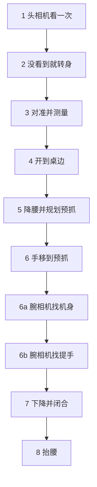

| 块 | 决定的事 | 交给谁执行 | 通过后的 stage |
| --- | --- | --- | --- |
| 1–2 | 头相机找红色收音机；看不到就原地每次转 45°，最多 8 次 | `segment_text`，底盘 `navigate_to_pose(..., planner="servo")` | `localized` |
| 3 | 转到画面中心，裁剪点云，量中心和尺寸 | SAM3 + `estimate_geometry` | `measured` |
| 4 | 开到桌边，再蠕行到约 0.68 m | 先 `planner="curobo"`，失败改 servo | `at_table` |
| 5 | 腰降到 0.25 m，近处重测，挑手臂和俯仰角 | `move_torso`，然后 `solve_ik` + `plan_motion` | `pregrasp_planned` |
| 6 | 手移到预抓位姿；差 3–5 cm 仍算到达 | `move_to_pose` | `at_pregrasp` |
| 6a | 腕相机找机身，看不到就抬高、偏移再看 | `segment_text`，`move_to_pose` | 仍是 `at_pregrasp`，或 `radio_not_found_by_wrist` |
| 6b | 四个文字提示里挑细的、高出桌面的部位，手移到它上方 | `segment_text`，`move_to_pose` | 仍是 `at_pregrasp`，或 `no_handle` / `recenter_failed` |
| 7 | 下降、闭合；夹爪读数 < 0.03 就转 90° 再夹一次 | `move_to_pose`，`close_gripper` | `closed` |
| 8 | 腰升高 0.15 m；腰动不了才改用手臂 | `move_torso`，失败才 `move_to_pose` | `lifted_attempt` |

## 3. 每次迭代改的是策略

相邻两次的差别，是「问规划器要哪个目标」，以及「什么时候相信感知」。规划器还是同一个。改动落在四类：

1. **目标位姿。** 蠕行从 0.62 m 改到 0.68 m，因为再近会把收音机碰起来。腰先试过前倾 0.3 rad，够不着，改成把 `waist_joint_1` 降到 0.25 m。这是在改交给规划器的起点和目标。
2. **认什么、丢什么。** 远处头相机中心常偏 15–45 cm，所以到桌边再测。腕部后几次检测只能微调：跳动超过 6 cm、分数低于 0.3、框贴在画面边上，都丢掉。提手最高点必须高出桌面 9 cm，否则桌上的电源线会被当成提手。
3. **失败后的下一步。** 夹爪读数 < 0.03 就回到预抓位姿，绕竖直轴转 90° 再夹。头相机在桌边看不到时，腕相机当前视角、抬高 12 cm、再在前后左右偏移处看。规划器每次仍只收一个位姿。
4. **执行器的 bug，不是策略。** IK 关节被多 batch 一次、抓取时收音机留在碰撞世界里、手指水平排除余量 5 cm、碰撞球缓冲，改的是 `planning.py` 和 cuRobo yaml。同一份 policy 重跑。这些会改变所有 seed 的规划结果。seed 36、26、27 成功时还没有后来那组碰撞缓冲。

到 seed 29 时，各 seed 的结果：

| seed | 起点 | 尝试 | 结果 |
| --- | --- | --- | --- |
| 36（诊断，不计入成绩） | 空程序 | 24 | 成功 |
| 26 | seed 36 的程序 | 13 | 成功 |
| 27 | seed 26 的程序 | 8 | 成功 |
| 28 | 前面积累的程序 | 14 | 未成功 |
| 29 | seed 28 的程序 | 1 | 第一次就成功 |

## 4. 各块流程图

### 1 头相机看一次

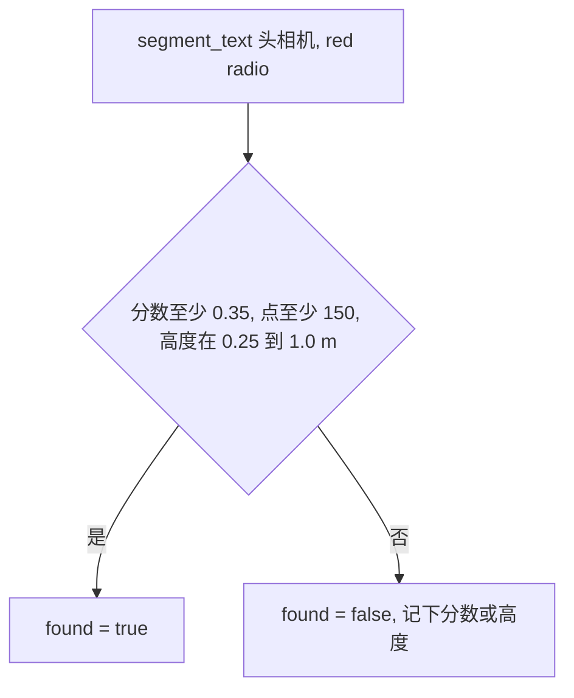

搜索门限是 `search_accept = 0.35`。真目标大约 0.56–0.83。seed 28 里窗外粉色物体是 0.248，用原来的 0.2 会被当成收音机。

### 2 没看到就转身

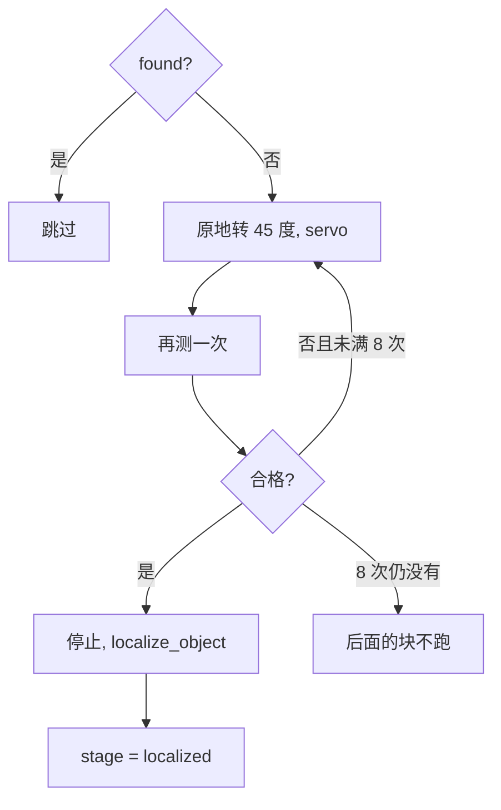

这一块从诊断 seed 就有。`localize_object` 只是再调一次 SAM3 并估计几何，低分也会返回成功，所以真正的门槛在上一块。

### 3 对准并测量

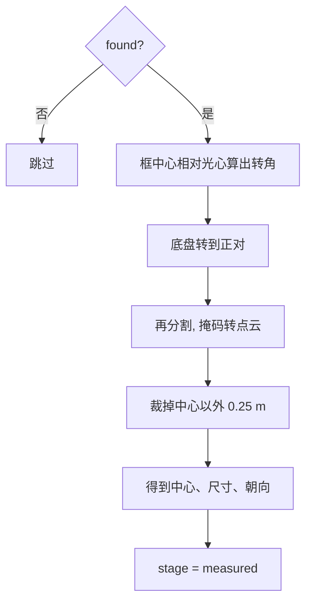

远处这一下经常偏 15–45 cm，所以到桌边还会重测。裁剪半宽 `crop_half_m = 0.25` 是为了去掉桌子以外的点。

### 4 开到桌边

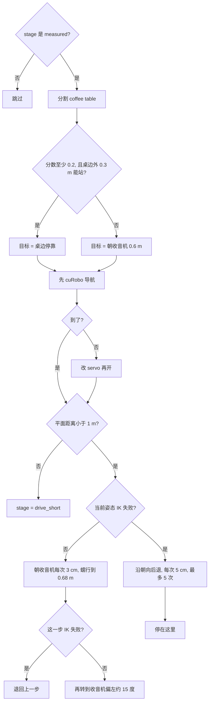

蠕行到 0.62 m 会碰到收音机，改成 `creep_target_m = 0.68`。桌边 cuRobo 判不可通行，所以失败后改用 servo。偏左 `left_bias_rad = 0.26`（约 15°）是为了让左肩更靠近物体。

### 5 降腰并规划预抓

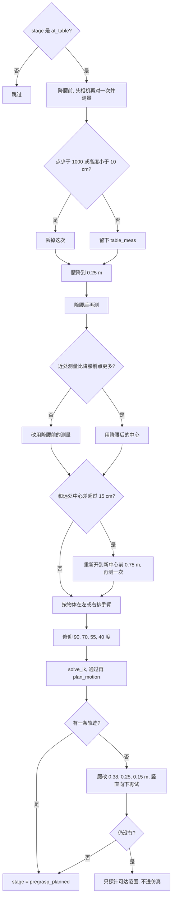

这一块改的是交给规划器的起点和目标：

- 腰从复位 0.509 m 降到 `lift_height = 0.25`。复位高度下手竖直向下只能往前约 0.46 m。0.30 m 约 0.68 m，0.15 m 约 0.76 m（离线 URDF，`gento-skye-import/reach_map.py`）。
- 远处中心不可信。降腰后再测；和远处中心差超过 15 cm 就重开到 `redrive_dist_m = 0.75`。0.72 m 时折叠的手臂会碰到 `waist_Link_3`。
- 重开后再测：和重开前的中心差超过 12 cm，或分数低于 0.3，丢掉。
- 四个俯仰角 `tilts_deg = [90, 70, 55, 40]` 和 cuRobo 调用方式基本没动。先试靠近物体那一侧的手臂。成功的几次都是 90°、第一条轨迹就通过。
- 关节路径回退被关掉（源码里 `if False`）。那条路径会偏 15–60 cm：harness 规划时腰是自由的，`solve_ik` 只返回手臂关节。
- 末端原点到指心 `finger_offset_m = 0.122`。预抓在目标沿接近方向再退 `pregrasp_clear_m = 0.14`。指心落在物体顶面下 `grasp_drop_m = 0.02`。

### 6 手移到预抓

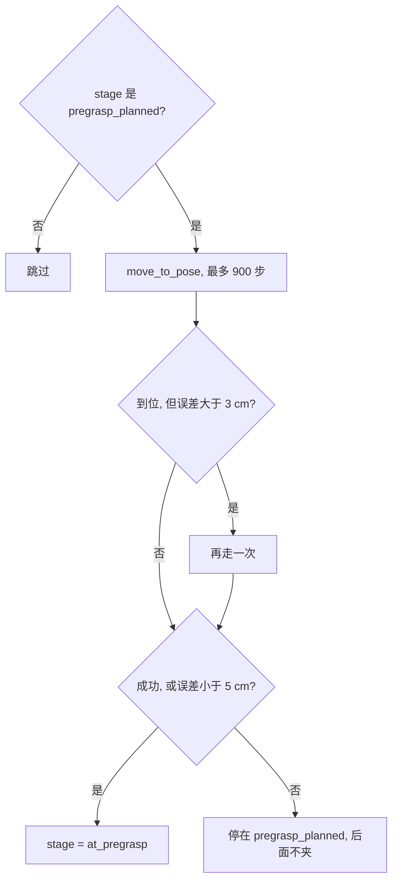

差 3–5 cm 仍算到达。seed 26 成功那次，下降停在目标上方 3.3 cm，夹爪已经夹住了。`reach_max_steps = 900`，默认 120 步只够很短的轨迹。

### 6a 腕相机找机身

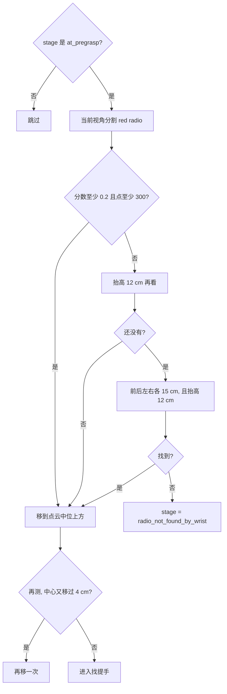

这是 seed 27 加上的。那个场景里头相机在桌边分数只有 0.02–0.03，腕相机抬高 12 cm 才看到机身（0.35–0.44）。`search_raise_m = 0.12`，`search_step_m = 0.15`。

### 6b 腕相机找提手

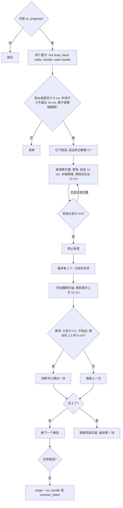

这一块用来区分「该夹的细部位」和「不该夹的东西」：

- 机身比约 8 cm 的开口宽，夹中心会夹空，所以改夹带子、铁丝提手或边缘。
- 腕部框面积超过画面一半，或宽、高小于 25 像素，直接丢掉。横跨或竖跨画面 90% 以上的框，分数乘 0.3。
- 桌上电源线的 `"black cable"` 也能到约 0.5，但只高出桌面约 6 cm。`handle_min_rise_m = 0.09`。带子大约 +12 cm，提手大约 +22 cm。
- 整台收音机也会被标成 handle（中间尺寸约 0.22 m）。三个尺寸排好后，中间那个不得超过 `handle_max_mid_extent_m = 0.16`。带子约 0.131，提手约 0.07，边缘约 0.046。
- 后一次检测：分数低于 0.3、框贴边、跳动超过 6 cm，或跳动小于 1.5 cm，都保留上一次。避免手漂到电源线上，也避免几乎没动的重测覆盖掉已经对准的点。
- 铁丝提手在长轴一端，所以先看两端（中心 ± 长边的一半，并抬高 12 cm），再看前后左右各 12 cm。有效分达到 0.6 就停止张望。最多试分数最高的 3 个。
- 指心高度取 `max(提手顶 − 0.02, 桌面 + 0.02)`，末端再沿 +Z 退后 0.122 m。预抓在这之上 0.12 m。对位误差小于 3 cm 也算对准。

### 7 下降并闭合

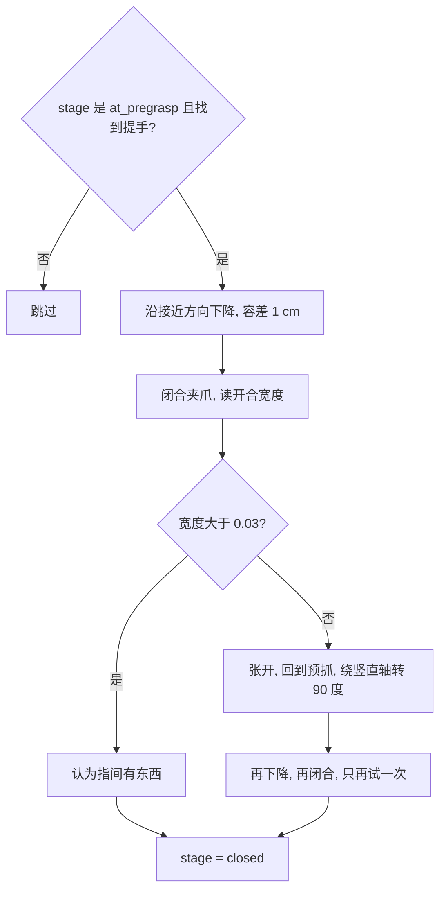

提手轴向从掩码看不准。`empty_close_below = 0.03`：读数接近 0 是指间空的，中间值是夹着东西，接近 1 是张着或顶住了比开口更宽的部位。seed 26 第 13 次第一次朝向读数已经是 0.212，没有用到第二次。seed 27 第 8 次是 0.966，夹到了几乎和开口一样宽的边缘。读数只说明指间有没有东西，不说明辅助关节是否连上收音机。下降停在容差外（`CONTROLLER_FAILED`）仍会闭合。

### 8 抬腰

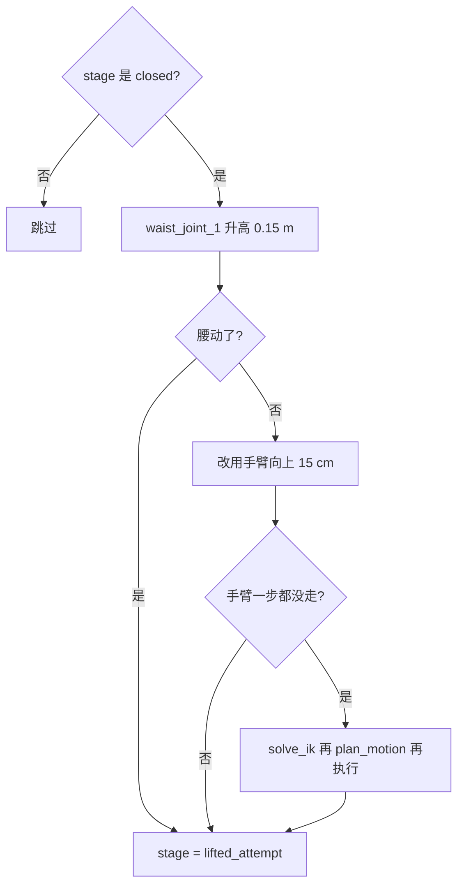

抬起优先用腰，避免再做一次手臂规划。`lift_m = 0.15` 盖得住官方要求的 10 cm。程序写完 `stage = lifted_attempt` 就结束，自己不知道这次算不算成功。
