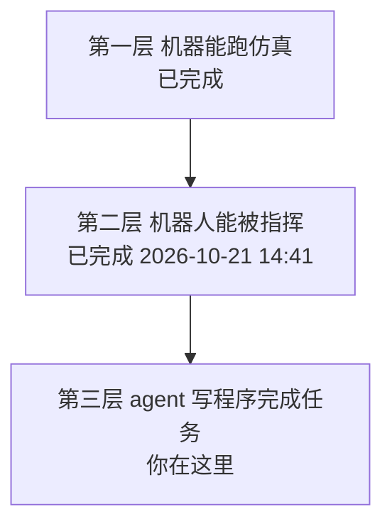
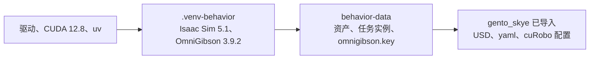
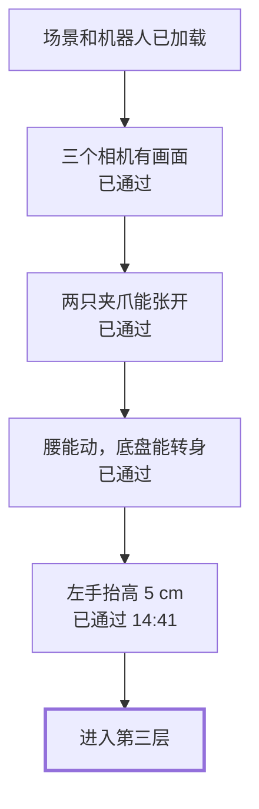
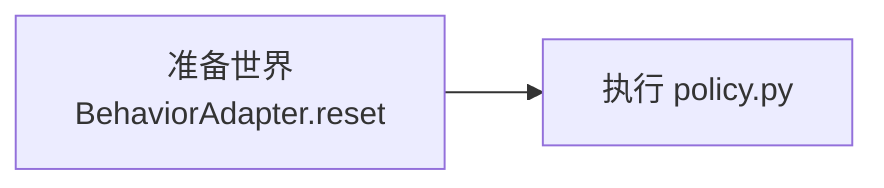
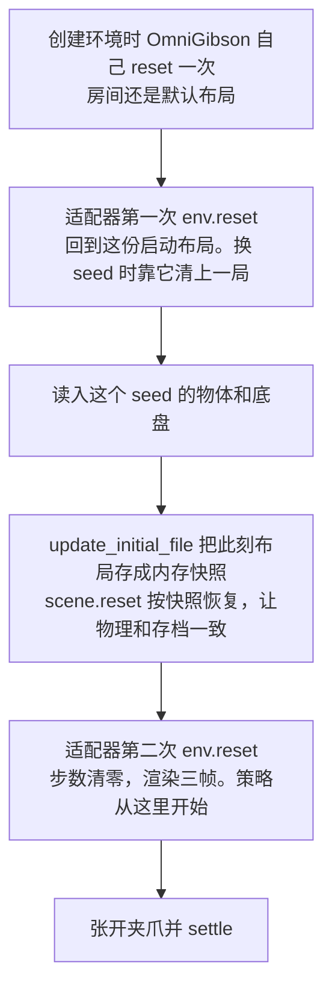
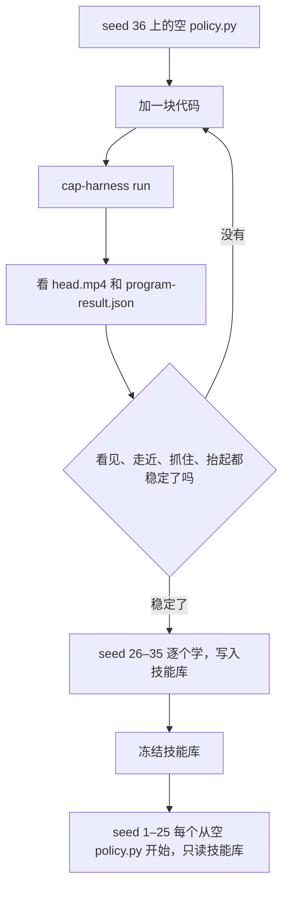

# Gento Skye 上的 ASPIRE：总框架

整件事只有三层。复位、关节顺序、碰撞球都是第二层里面的分支，不是并列的主流程。

第二层已经全部通过：14:41 那次 bring-up（`run-20261021T144134.541951Z-09c1c68c`）里相机、夹爪、腰、转身、左手抬高 5 cm 都为真。现在进入第三层。全流程、改过的文件和所有踩过的坑汇总在 [gento-skye-README.md](gento-skye-README.md)。

操作命令在 [gento-skye-aspire.md](gento-skye-aspire.md) 和 [gento-skye-startup.md](gento-skye-startup.md)。每一轮报错和改过的数在 [gento-skye-troubleshooting.md](gento-skye-troubleshooting.md)。安装过程在 [gpufree-behavior-gento-skye.md](gpufree-behavior-gento-skye.md)。

`examples/behavior/_prelude.py` 不在这三层里面。它是 R1 Pro 走完第三层之后贴进仓库的程序。

## 第一层：机器能跑仿真

这一层的完成标准是：一个 Isaac 进程能加载 BEHAVIOR 场景，并生成 Gento Skye。

| 分支 | 内容 | 状态 |
| --- | --- | --- |
| 主机 | Ubuntu 22.04，单卡 RTX 4090，CUDA 12.8。同一时间只能有一个 Isaac | 完成 |
| 运行时 | `.venv-behavior`。不要在这个环境里 `uv sync`，否则会卸掉 Isaac wheel | 完成 |
| 数据 | `/root/gpufree-data/aspire/behavior-data`。本机下不了 Hugging Face，包来自 ModelScope | 完成 |
| 机器人 | `omnigibson-robot-assets/models/gento_skye/`。模型名 `gento_skye`，29 个活动关节 | 完成 |
| 感知权重 | SAM3 在 8114，Contact-GraspNet 在 8115。bring-up 不用启动 | 已安装，任务阶段才开 |

这一层不再改。新 shell 要导出的变量见 [gento-skye-startup.md](gento-skye-startup.md)。

## 第二层：机器人能被指挥

这一层不捡收音机。它只确认公开接口能驱动这台机器人。程序是 `outputs/gento-bringup/policy.py`，场景固定用 seed 36。seed 36 只决定用哪一份房间实例，避免占用评测用的 seed 1–25。

通过标准是四条：

1. 身体朝上，轮子着地，不穿门框。
2. 头、左腕、右腕三个相机有画面。
3. 两只夹爪能张开，腰能动，底盘能转身，cuRobo 能让左手末端抬高 5 cm。
4. 末端 +Z 从指尖指出，Y 横跨两指。

四条都已通过（第 1 条里底盘仍站在 R1 Pro 的采样点上，`dx, dy, dz` 为 0，但不穿门框、不挡规划）。5 cm 是这份检查程序自己写的短距离，不是任务成功条件。任务成功是另一件事：夹爪握住目标，并且目标比加载时至少高出 5 mm。

### 检查清单

12:57 那次完整运行里 `reach_ok` 为假；碰撞球重做之后，14:41 那次 `program_ok` 为真，147 步，六项全部为真，`move_to_pose` 执行 29 步、末端误差约 7.7 mm。

### 一次运行只有两段

`cap-harness run` 先准备世界，再执行 `--program` 指向的那一个文件。策略永远在第二段。

`BehaviorAdapter` 是 ASPIRE 和 Isaac 之间的翻译。`policy.py` 只能调用 `get_observation`、`open_gripper`、`move_to_pose` 这些公开接口。适配器拿着 `og.Environment`，把「主臂」对到 Gento 的左臂，把 R1 Pro 的底盘采样换成 `_gento_base_pose`，再把动作交给关节控制器和进程内 cuRobo。

准备世界里面有多次名叫 `reset` 的调用，都算这一段，不是把关节反复归零：

快照是场景对象里的 `_initial_file`，不是磁盘上的 USD。窗口里拖动机器人不会改它。底盘偏移必须在 `write_task_metadata` 和 `update_initial_file` 之前写好，否则下一次 `scene.reset()` 会把机器人摆回旧布局。

计时里的 `reset` 是整段准备，含加载、存档、恢复、开夹爪和静止。12:57 那次大约 188 秒。

### 抬手失败：已解决的分支

正运动学和仿真的差是 0 cm，所以失败不在模型对不上，也不在关节顺序，全部出在 cuRobo 的碰撞模型。四份 yaml 和导入配置的 `curobo` 段一起改，原文件在 `models/gento_skye/misc/curobo-backup-20261021/`。设计和验证见 [gento-skye-collision-spheres.md](gento-skye-collision-spheres.md)。

| 轮次 | 诊断看到的 | 改了什么 | 改完之后 |
| --- | --- | --- | --- |
| 13:07 | 场景碰撞是两只轮子贴地。`base_link` 一颗半径 0.735 m 的球把腰和手臂包住，重叠 30–66 cm | 底盘手工排 13 颗球，轮子半径 0.04 m，`waist_Link_2/3` 加入 `base_link` 的忽略列表 | 场景碰撞消失 |
| 13:21 | 剩下的是手腕、肩和腰这些本来就挨着的连杆，重叠 4–8 cm | 每只手补 14 对忽略，左右共 28 对 | 这 8 对消失 |
| 13:30 | 还剩腰部隔一节，以及四个轮子对 `base_link`，共 5 对 | 这 5 对写入忽略列表。诊断加上左手逆解自检 | 没有验证就被第四轮替换 |
| 第四轮 | 用户指出：靠忽略绕开重叠会漏掉真碰撞，根子是每个连杆只有一颗外接球 | 按网格重新拟合 215 颗球；19 个底盘附件移出碰撞模型；忽略列表按“父子、刚体组、实测始终贴合、采样从未靠近”重建，撤掉底盘↔腰、躯干↔肩 | 14:41 bring-up 全部通过 |

前三轮的忽略做法是错的，已经全部被第四轮替换，不要照着恢复。

以后再遇到 `IK Fail`，先开 `GENTO_PLAN_DIAG=1` 看自检：

| 自检 | 下一步 |
| --- | --- |
| 两次都有解，`reach_ok` 仍为假 | 查 `planning.py` 里目标位姿从 odom 到世界的换算 |
| 原地无解 | 还有没列出来的碰撞或限位 |
| 原地有解、上抬无解 | 复位手臂角接近够不着的边缘，再改 `RESET_JOINT_POSITIONS`，并同步 `gento_skye.yaml` 的 `default_joint_pos` |
| `与场景碰撞` 又变成真，而且连杆是家具 | 改 `adapter.py` 里 `_gento_base_pose` 的 `dx` 或 `dy`，每次大约 0.3 m |
| 自身重叠深度达到几厘米以上 | 先查碰撞球（`check_collision_spheres.py`），不要先加忽略 |

### 第二层里已经做完的分支

这些曾经挡住启动或看起来像抬手失败，现在不要再当成主线去改。

| 分支 | 结果 |
| --- | --- |
| 关节顺序 | 运行时不是「左臂 7 个再右臂 7 个」。6 个底盘、3 个腰，然后头和左右臂交错，最后 4 个手指。`config.py` 和 yaml 已按这个顺序对齐 |
| 夹爪方向 | `grasping_direction` 是 `upper`。关节值 0 是张开，0.04 m 是闭合 |
| 头相机 | 原来对着外壳。USD 里绕 Y 转 180° 并前移 1 cm 之后能看到房间 |
| 末端轴 | 12:23 停窗核对过。手指中心在末端坐标里 z = +0.122，y = ±0.016。不用重导 |
| 底盘朝向 | `_gento_base_pose` 清掉滚转和俯仰，偏航减 90°。`dx, dy, dz` 仍是 0，机器人还在 R1 Pro 的采样点。IK 失败不是这个位置造成的 |
| 碰撞球 | 按网格重新拟合，见 [gento-skye-collision-spheres.md](gento-skye-collision-spheres.md) |
| 停窗卡死 | `GENTO_HOLD` 改成等待时持续渲染，窗口可以操作 |
| cuRobo 动态库 | `LD_LIBRARY_PATH` 指向虚拟环境里的 `libnvrtc-builtins.so.12.6`。缺它时规划还没开始就失败 |

关节顺序的 29 个数写在 [gento-skye-aspire.md](gento-skye-aspire.md) 第 1 步。以后改某一个角，两处一起改，不要按 URDF 出现顺序重排。

## 第三层：agent 写程序完成任务

2026-10-21 14:41 起可以进入。开始前另开终端启动 SAM3 和 Contact-GraspNet（[gento-skye-startup.md](gento-skye-startup.md) 第 3 节），并 `unset GENTO_PLAN_DIAG GENTO_HOLD`。agent 读的是视频、`outcome.json` 和程序自己的 `report`，然后改下一块代码。流程以 `.claude/skills/iterative-debugging/behavior/SKILL.md` 为准。

| 分支 | 做什么 | 不做什么 |
| --- | --- | --- |
| 诊断 seed 36 | 从空的 `outputs/runs/gento-skye-radio/.../policy.py` 写起。第一块只让头相机找红色收音机 | 不把 `turning_on_radio_seed1.py` 贴进去。诊断结果不写进评测结论 |
| 学习 seed 26–35 | 每个 seed 从空程序开始，把测过的距离、朝向、失败原因写入 `$RUN_ROOT/behavior/skill-library/` | 不从 R1 Pro 的例子抄 0.8 m 伸手距离和 12.7 cm 手指间距 |
| 评测 seed 1–25 | 技能库冻结之后才跑。每个 seed 仍从空程序开始，只读冻结后的技能库 | 调试机器人时不要碰这些 seed |
| 例子程序 | `examples/behavior/` 是 R1 Pro 的对照。`_prelude.py` 的正文被复制进 `turning_on_radio_seed1.py` 和 `picking_up_trash_seed1.py` 的上半部，测试要求逐字相同 | 不改 `_prelude.py` 来修 Gento。要沿用函数就复制到自己的 `policy.py` 再改 |

seed 36 的收音机在机器人左后方的茶几上，复位时头朝壁炉和电视。第一块里 `found` 为假是预期的，下一块再转身或开走。

`move_to_pose` 和 `plan_motion` 的 `max_steps` 要给到 600–900。默认 120 只够很短的轨迹。抓取从 `head` 相机来，接近方向沿末端 +Z，从上往下。成功与否看 `evaluation/protocol.json` 的 `checks.held` 和 `max_clearance_m`，程序自己读不到这个判定。

命令和第一块代码在 [gento-skye-aspire.md](gento-skye-aspire.md) 第 5 步。
